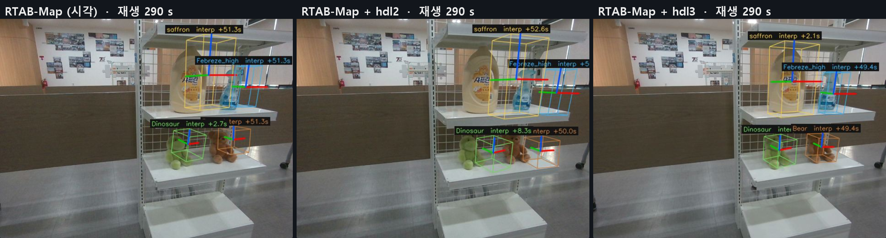
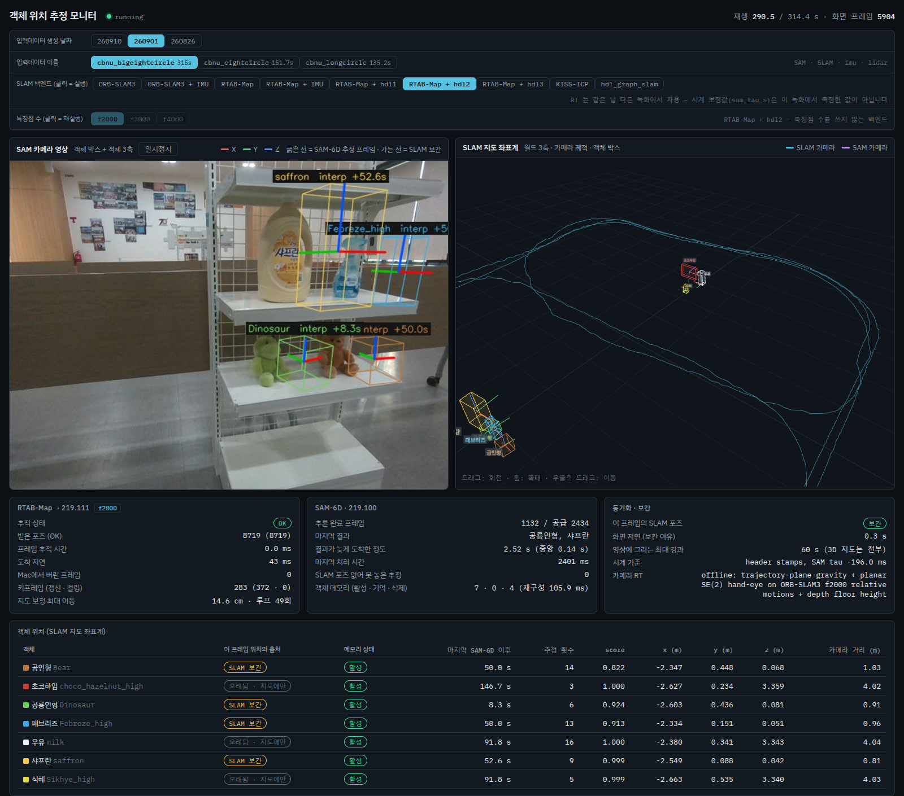
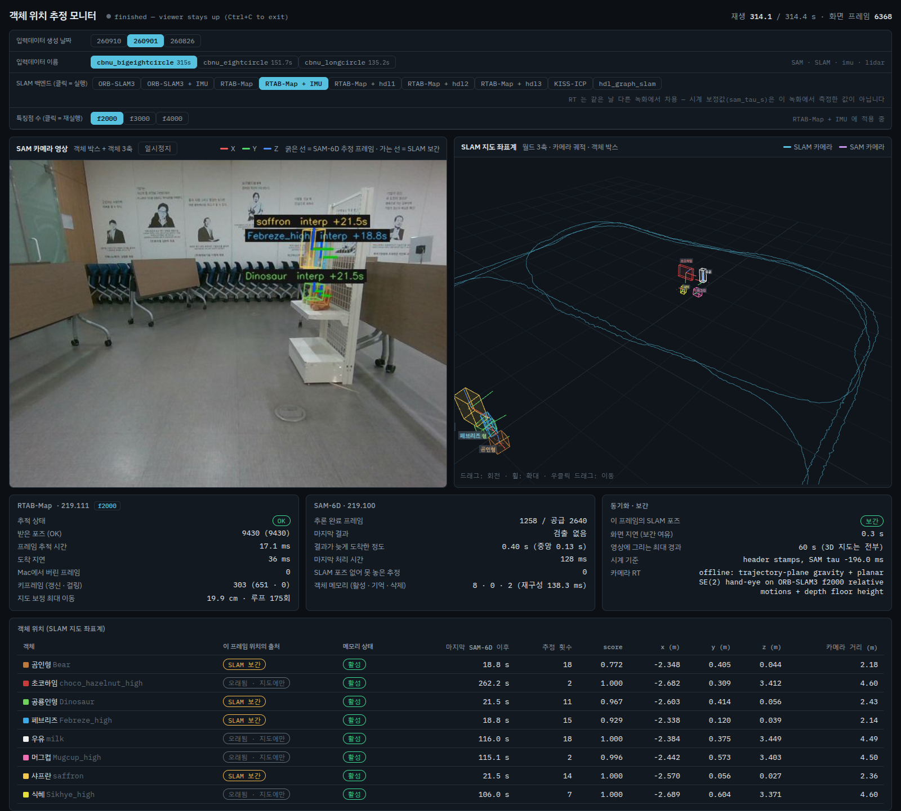

# RTAB-Map 백엔드 비교 — 시각 · IMU · hdl1/2/3 (260901 bigeightcircle)

2026-09-24 · JeungChul Park

## 요약

객체 지도에는 RTAB-Map + hdl3 가 가장 좋고(객체 퍼짐 1.7 cm, 두 번 모두), hdl2 가 가장 나쁘다(3.5~6.4 cm). HDL_STYLE.md 가 hdl2 를 권장한 근거인 재방문 일관성은 진행 방향 오차를 보지 못한다.

| 백엔드 | 객체 퍼짐 (live, 실행별) | 판정 |
| --- | --- | --- |
| RTAB-Map | 2.06 · 2.06 · 2.45 cm | 안정적. 루프 170회 안팎, 지도 보정이 최대 30 cm 로 크다 |
| RTAB-Map + IMU | 2.25 cm | 기울기 오차 꼬리가 절반으로 줄지만 위치는 그대로 |
| RTAB-Map + hdl1 | 3.57 cm | point-to-plane 때문에 진행 방향으로 밀림 |
| RTAB-Map + hdl2 | 6.43 · 3.49 cm | 같은 원인. 재방문 지표는 1등이지만 영상에서 박스가 밀린 것이 보인다 |
| RTAB-Map + hdl3 | 1.68 · 1.71 cm | 최선. 루프가 거의 없어 KISS 궤적(1.57 cm)에 가깝다 |

확인한 것 세 가지:

1. 원인은 point-to-plane ICP 다. 스캔의 가장 약한 축이 진행 방향인 노드가 85~92 % 다. point-to-point 로 바꾸면 반경과 관계없이 객체 1.7 cm 로 돌아온다.
2. HDL_STYLE.md 의 hdl3 +54.2 % 는 재현되지 않는다. 오프라인 다섯 번과 live 두 번을 더 돌리자 모두 −0.4~+3.7 % 였다. 같은 입력에서도 ICP 링크 값이 실행마다 달라(최대 5.5 mm) 결과가 퍼진다.
3. RTAB-Map + IMU 는 이미 돌아간다. 뷰어 탭의 "미구현" 표시는 오래된 정보였다.

데이터는 `260901_cbnu_bigeightcircle` 하나뿐이다. 백엔드마다 1~3회 live 실행했다.

## 실험 설정

다섯 백엔드 모두 Mac 의 같은 `rtab_stream`(RTAB-Map 0.23.8)으로 `260901_cbnu_bigeightcircle`(314 s, 카메라 9445 프레임, VLP-16 3124 스캔)을 1배속 live 로 재생했다. PC 에서는 SAM-6D 가 객체 포즈를 추정해 SLAM 궤적 위에 배치한다.

| 백엔드 | 오도메트리 | 루프 정합 | 추가 파라미터 |
| --- | --- | --- | --- |
| RTAB-Map | 시각 (F2M, Vis/MaxFeatures 2000) | 시각 | — |
| RTAB-Map + IMU | 시각 + Xsens IMU (`--gyro`) | 시각 | IMU 를 SensorData 에 넣음, 노드마다 중력 링크 |
| RTAB-Map + hdl1 | KISS-ICP 궤적 주입 | 라이다 ICP | `Icp/PointToPlane=true` |
| RTAB-Map + hdl2 | KISS-ICP 궤적 주입 | 라이다 ICP | hdl1 + `RGBD/LocalRadius=1.0` |
| RTAB-Map + hdl3 | KISS-ICP 궤적 주입 | 라이다 ICP | hdl2 + `Rtabmap/LoopThr=1.0` (외형 루프 끔) |

hdl 세 변형은 hdl_graph_slam 을 돌린 것이 아니다. 그 루프 방식을 RTAB-Map 파라미터로 한 단계씩 옮긴 것이다(Mac `rt/260901/rtab_odom/HDL_STYLE.md`).

**지표**

- **재방문 일관성** — HDL_STYLE.md 의 지표. 30 s 이상 떨어진 두 통과가 1 m 안에서 가장 가까울 때의 거리 중앙값이다. 입력 KISS 궤적 대비 % 로 적고, 음수가 개선이다.
- **객체 관측 퍼짐** — 같은 객체의 SAM-6D 관측들을 최종 궤적에 놓았을 때 그 중앙값에서 떨어진 거리의 중앙값(cm)이다. 객체 8종의 중앙값을 쓴다. 이 시스템의 목적(객체 지도)에 가장 가까운 지표다.
- **진행/횡방향 편차** — 객체 관측 시점에서 궤적이 KISS 와 얼마나 다른지를 로봇 진행 방향과 그 직각 방향으로 나눈 값이다. KISS 는 hdl 의 입력이므로, 이 값은 참값 오차가 아니라 루프 보정이 궤적을 옮긴 양이다.

## 결과 — live 다섯 실행

객체 위치는 hdl3 가 가장 좋고(1.68 cm), hdl2 가 가장 나쁘다(6.43 cm). 재방문 지표는 정반대로 hdl2 가 1등이다. 시각 RTAB-Map 과 IMU 를 더한 버전은 그 사이(2.06, 2.25 cm)에 있다.

| 백엔드 | 루프 이벤트 | 지도 보정 최대 | 재방문 (KISS 대비) | 객체 퍼짐 | 관측 시점 진행/횡 편차 | KISS 와 ATE | 맵 갱신 평균 | 랜드마크 활성/삭제 |
| --- | --- | --- | --- | --- | --- | --- | --- | --- |
| RTAB-Map | 173 | 30.7 cm | +5.5 % | 2.06 cm | 1.10 / 1.96 cm | 4.5 cm | 95 ms | 8 / 2 |
| RTAB-Map + IMU | 175 | 19.9 cm | +4.3 % | 2.25 cm | 1.94 / 3.78 cm | 4.7 cm | 123 ms | 8 / 2 |
| RTAB-Map + hdl1 | 50 | 11.4 cm | −10.0 % | 3.57 cm | 1.99 / 2.18 cm | 4.3 cm | 211 ms | 9 / 3 |
| RTAB-Map + hdl2 | 44 | 15.6 cm | **−16.7 %** | 6.43 cm | 4.98 / 3.01 cm | 6.4 cm | 215 ms | 9 / 1 |
| RTAB-Map + hdl3 | 7 | 5.1 cm | +1.9 % | **1.68 cm** | 0.24 / 1.01 cm | 2.8 cm | 67 ms | 8 / 1 |
| (참고) 루프 없는 KISS 궤적 | — | — | 0 % | 1.57 cm | 0 / 0 | 0 | — | — |

- 재방문, 객체 퍼짐, 편차, ATE 는 라이브 포즈를 최종 키프레임 그래프에 다시 맞춘 궤적으로 계산했다.
- 객체 퍼짐은 모든 행에 같은 SAM-6D 추정 120개를 적용했다. 그래서 차이는 궤적에서만 온다.
- 다섯 실행 모두 9430 포즈를 빠짐없이 받았고, 도착 지연은 0.2 s 이하였다.
- 시각 RTAB-Map 은 9/23 17:21 에도 한 번 돌렸다. 그때는 ATE 17.8 cm, pitch 오차 3.6° 로 훨씬 나빴다. 이 실행은 Mac 의 `rtab_stream` 을 다시 빌드한 시각(9/23 19:39)보다 앞서서 비교에서 배제했다. 빌드 차이 때문인지 실행 간 흔들림인지는 확인하지 않았다.

## 확인 1 — point-to-plane 이 진행 방향 오차를 만든다 (1 m 반경은 무관)

라이다 루프가 객체 위치를 나쁘게 만드는 원인은 point-to-plane ICP 다. 이 환경의 스캔은 로봇 진행 방향으로 제약이 약해서, 루프 링크가 그 방향으로 미끄러진다. 앞서 추정한 "1 m 근접 반경" 은 원인이 아니었다.

**재방문 지표의 사각지대.** 재방문 일관성은 다른 바퀴의 가장 가까운 점까지 거리를 잰다. 그래서 같은 선 위에서 진행 방향으로 밀린 오차는 보이지 않는다. live hdl2 는 이 지표가 가장 좋았지만(−16.7 %), 객체 관측 시점에 진행 방향으로 5.0 cm 밀려 있었고 객체 퍼짐이 6.4 cm 로 가장 컸다.

**대조 실험** — Mac 오프라인, 같은 KISS 입력. SAM-6D 추정 120개(hdl1 live 실행분)를 모든 궤적에 똑같이 적용했다. 그래서 객체 퍼짐의 차이는 오로지 궤적에서 온다.

| 정합 | 반경 | 실행 | 루프 링크 | 링크의 진행 방향 편차 중앙값 / 상위 10 % | 재방문 | 객체 퍼짐 |
| --- | --- | --- | --- | --- | --- | --- |
| point-to-point | 10 m | p2p_r10 | 149 | 0.90 / 2.1 cm | −3.8 % | 1.77 cm |
| point-to-point | 1 m | hdl2_p2p | 214 | 0.97 / 2.2 cm | −7.2 % | 1.73 cm |
| point-to-plane | 10 m | hdl1 재실행 | 63 | 2.67 / 10.5 cm | +5.3 % | 3.39 cm |
| point-to-plane | 1 m | hdl2 재실행 | 86 | 2.73 / 11.0 cm | −19.5 % | 2.82 cm |
| point-to-plane | 1 m | hdl2 f2000 | 102 | 2.55 / 8.9 cm | −15.0 % | 2.34 cm |

여기서 링크의 편차는 루프 링크가 제시한 상대 이동과 KISS 오도메트리의 상대 이동이 로봇 진행 축(base x)으로 다른 양이다. KISS 는 링크당 σ ≈ 1 cm 이다. point-to-point 링크는 그 수준에 맞고, point-to-plane 링크는 3배 크고 꼬리가 길다. 반경 1 m 와 10 m 의 차이는 두 정합 방식 모두에서 작다.

**스캔의 퇴화.** hdl2 재실행의 노드 스캔으로 point-to-plane 법선 행렬(Σ n nᵀ, voxel 0.05 m, k = 5)을 계산했다. 가장 약한 축이 base x 인 노드는 전체의 85 %, 루프 링크 노드의 92 % 였다. 약한 축의 고유값은 가장 강한 축의 약 1/27(λmin/λmax 중앙값 0.037)이다. 양옆 벽이 지배하는 복도형 장면의 전형적인 퇴화다.

루프를 걸어도 회전은 망가지지 않았다. hdl 세 변형 모두 KISS 대비 회전 차이가 0.13° 이하다. 문제는 위치, 그중에서도 진행 방향이다.

## 실행 화면 — 같은 장면, 세 백엔드

진행 방향 오차는 영상 위 객체 박스가 실물에서 한 방향으로 밀리는 모습으로 보인다. 세 백엔드를 다시 live 로 돌리면서, 마지막 바퀴에서 선반을 지나는 290 s 에 뷰어를 캡처했다.

- **hdl2 (가운데):** saffron, Febreze, Bear 박스가 모두 실물보다 오른쪽으로 밀려 있다. 개별 오차가 아니라 궤적 자체가 옮겨진 모습이다. 이 실행에서 가장 크게 벗어난 관측도 288~291 s 의 saffron, Febreze, Dinosaur(11~12 cm)였다.
- **hdl3 (오른쪽):** 네 박스가 모두 실물에 맞는다. 루프를 거의 걸지 않아 KISS 궤적이 그대로 쓰였다.
- **RTAB-Map (왼쪽):** 대체로 맞지만 Febreze 박스는 조금 오른쪽이다.
- 박스는 객체 메모리가 누적한 위치를 현재 카메라에 투영한 것이다. 라벨의 "+51 s" 는 마지막 SAM-6D 검출 후 지난 시간이다.
- 세 화면은 표시 프레임이 5899~5904 로 약 0.1 s 다르다. 카메라 시점이 조금씩 다른 것은 이 때문이다.

이 캡처 실행들도 따로 채점했다. 객체 퍼짐은 RTAB-Map 2.45 cm, hdl2 3.49 cm, hdl3 1.71 cm 로 순서가 같았다. hdl2 는 첫 실행(6.43 cm)보다는 덜 나빴다. 하지만 두 실행 모두 89~92 s 와 288~291 s 구간에서 같은 객체들이 10 cm 이상 벗어났다. 틀어지는 자리가 매번 같다는 뜻이다.

hdl2 의 같은 시각 전체 화면이다. 루프 49회, 지도 보정 최대 14.6 cm 다. 오른쪽 지도에서 바퀴마다 궤적이 두세 갈래로 나뉘어 있다.

## 확인 2 — hdl3 의 live/오프라인 차이는 실행 간 비결정성이다

HDL_STYLE.md 의 hdl3 +54.2 % 는 재현되지 않는 드문 실행이었다. 같은 설정을 오프라인으로 다섯 번, live 로 두 번 더 돌리자 모두 −0.4~+3.7 % 였다. 문서 실행에는 근접 링크가 1개뿐이었고, 재실행에서는 6~8개가 생겼다.

| 설정 | 실행 (루프 링크 수) | 재방문 % | 객체 퍼짐 |
| --- | --- | --- | --- |
| hdl1 | 문서 −9.9 · live −10.0 · 병렬 재실행 +5.3 (63) · 직렬 −1.0 (63), −0.8 (41) | −10.0 ~ +5.3 | 2.6 ~ 4.1 cm |
| hdl2 | 문서 −14.7 · live −16.7, −9.0 · 재실행 −19.5 (86), f2000 −15.0 (102) | −19.5 ~ −9.0 | 2.0 ~ 6.4 cm |
| hdl3 | 문서 +54.2 (1) · live +1.9, +3.7 · 재실행 −0.4 (12), +2.0 (12), f2000 +1.9 (12) · 직렬 +0.1, 0.0 (11) | 문서 제외 −0.4 ~ +3.7 | 1.6 ~ 1.7 cm |

객체 퍼짐은 모두 같은 SAM-6D 추정 120개로 계산했다. 괄호 안 루프 링크 수는 오프라인 DB 의 노드 쌍 기준(전역 + 근접)이고, live 실행은 DB 를 남기지 않아 비워 두었다.

**원인.** 두 직렬 실행의 입력은 비트 단위로 같았다(오도메트리 포즈 315/315 동일). 반면 같은 노드 쌍의 ICP 링크 값은 실행마다 달랐다. hdl1 에서 공통 링크 21개 중 17개가 다르고, 차이는 최대 5.5 mm 다. 첫 루프 링크(노드 10)부터 갈라진다. 이 작은 차이가 링크의 수락/거부를 뒤집고, 그래프가 달라지면 다음 후보도 달라진다.

`rtab_stream` 의 오프라인 모드는 벽시계와 무관한 동기식이다. 따라서 비결정성은 RTAB-Map/PCL 내부에서 생긴다. 멀티스레드 법선·kd-tree 계산의 부동소수점 순서를 의심하지만, 확인하지는 않았다.

**의미.** 실행 한 번으로 변형 간 우열을 가리기는 어렵다. 특히 hdl1 의 재방문 지표는 실행마다 15 %p 흔들린다. 반면 "hdl3 가 객체 위치에 가장 좋다" 는 결론은 일곱 번 모두 유지됐다. 루프 링크가 적어 흔들림의 영향도 작다.

부수 발견: PC 의 `Dataset/260901_cbnu_bigeightcircle/lidar/*.db3` 사본은 메시지 id 2501 부근부터 SQLite 페이지가 손상돼 있다. SLAM 은 Mac 사본을 쓰므로 이 문서의 결과에는 영향이 없다.

## RTAB-Map + IMU — 기울기의 큰 오차는 줄었고, 위치는 그대로다

IMU 를 넣으면 최종 궤적의 roll/pitch 오차 꼬리가 절반 가까이 줄었다. 위치 정확도(ATE 4.5 → 4.7 cm)와 객체 퍼짐(2.06 → 2.25 cm)은 사실상 같다. 각각 한 번씩 돌린 결과라 이 정도 차이는 실행 간 흔들림 안에 있다.

| KISS 대비 회전 오차 (최종 궤적) | RTAB-Map | RTAB-Map + IMU |
| --- | --- | --- |
| pitch 중앙값 / 상위 5 % | 0.73 / 3.26° | 0.60 / 2.11° |
| roll 중앙값 / 상위 5 % | 1.06 / 4.76° | 0.48 / 2.49° |
| yaw 중앙값 / 상위 5 % | 0.42 / 1.32° | 0.46 / 1.57° |

- IMU 입력: Xsens 200 Hz, 63013 샘플. 카메라와의 시간차는 −2.74 ms 다. 가장 조용한 샘플 6301개로 잰 중력은 base 기준 (0.53, −0.04, 9.78) m/s² 로, 방향이 맞다.
- 이 탭은 이제 뷰어에서 바로 실행된다. PC 카탈로그에는 "rtab_stream 에 IMU 경로 미구현" 으로 남아 있었는데, Mac 빌드는 이미 `--gyro` 를 지원했다.

실행이 끝난 뒤(314 s)의 뷰어 화면이다. 오른쪽 지도에서 바퀴마다 궤적이 한 줄로 겹치지 않고 여러 갈래로 벌어진다. 이것은 실시간 포즈(루프 보정 전)를 그린 것이다. 왼쪽 영상에서는 saffron, Febreze, Dinosaur 박스가 실제 물체 위치에 맞게 그려져 있다.

## 권장과 남은 일

객체 지도를 만드는 목적이면 RTAB-Map + hdl3 를 기본으로 쓴다. 루프가 꼭 필요한 세션이면 point-to-point 라이다 루프(hdl2_p2p, 객체 1.73 cm)를 쓴다. point-to-plane 을 켜는 hdl1·hdl2 는 이 환경에서 쓰지 않는다.

- [ ] 나머지 세 세션(eightcircle, longcircle, digut)에서 같은 비교를 반복한다. HDL_STYLE.md 에서 루프가 필요했던 세션이 포함된다.
- [ ] 변형마다 3회 이상 반복 실행해 평균과 편차로 비교한다. 한 번의 실행으로는 재방문 지표가 15 %p 흔들린다.
- [ ] ICP 비결정성의 원인을 찾는다. OpenMP 스레드를 1개로 고정(`OMP_NUM_THREADS=1`)해 같은 결과가 나오는지 본다.
- [ ] HDL_STYLE.md 에 정정을 기록한다. hdl2 권장, hdl3 +54.2 %, "1 m 반경이 틀린 링크를 줄인다" 는 모두 이 문서로 대체된다.
- [ ] hdl 탭에서 `--features 2000` 을 넘기지 않게 한다. 실험상 영향은 없었다(hdl3 f2000 +1.9 % vs 기본 +2.0 %).
- [ ] PC 의 bigeightcircle 라이다 bag 사본을 Mac 에서 다시 복사한다.

**읽을 때 주의**

- KISS 는 hdl 의 입력이다. 그래서 KISS 대비 편차와 ATE 는 참값 오차가 아니라 루프가 궤적을 얼마나 바꿨는지를 뜻한다.
- 객체 퍼짐은 참값이 없는 자기 일관성 지표다. 같은 객체를 다른 바퀴에서 본 위치가 얼마나 같은지를 잰다.
- milk 는 211 s 에 모든 백엔드에서 20 cm 이상 벗어난다. 궤적이 아니라 SAM-6D 의 오인식으로 보인다.
- 객체 메모리의 활성/삭제 수는 SAM-6D 검출에 따라 실행마다 달라진다. 예를 들어 RTAB-Map 캡처 실행은 활성 6 / 삭제 7 이었다. 이 차이는 SLAM 백엔드의 품질을 나타내지 않는다.

원자료: PC `objpose/output/live_260901_cbnu_bigeightcircle_rtabmap*` (`_r1`, `_r2` 는 앞선 실행), Mac `~/objpose_tmp/hdlcheck/` (오프라인 대조 실험과 RTAB-Map DB).
