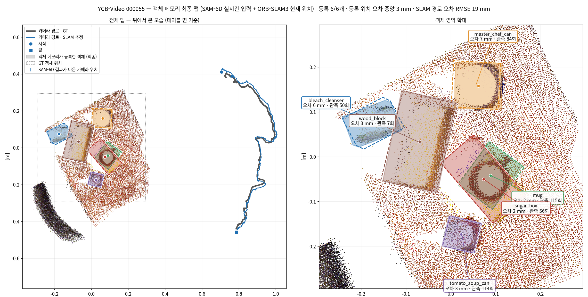

# YCB-Video — SLAM 현재 위치 기반 객체 메모리: 장면별 최종 맵 (2026-09-22)

장면마다 **ORB-SLAM3 가 추적 직후 낸 현재 위치**와 **실시간 입력 SAM-6D 결과**로 객체 메모리를 돌렸다.
최종 맵, 등록된 객체 위치, 카메라 추적 경로를 한 장에 그렸다.

## 구성 (hub 와 같은 경로)

| 요소 | 사용한 것 |
|---|---|
| 카메라 위치 | `output/ycbv_slam_orb_260921/<scene>_frames.txt` (ORB-SLAM3 RGB-D, 프레임별 추적 직후 포즈) → `pc/fusion.PoseBuffer` |
| 객체 관측 | `output/ycbv_sam6d_realtime_260921/<scene>/sam6d_frames.jsonl` (실시간 입력, 결과가 나온 순서대로) → `pc/memory.ObjectMemory` |
| 메모리 설정 | hub 기본값: 위치 연관 게이트 0.30 m, 회전 게이트 없음, 깊이 검사(free 0.15 m, 연속 3프레임, 0.6 m/s, 45 °/s) |
| 최종 맵 | 메모리 상태가 active · lost · remembered 인 객체 |
| 배경 점군 | 15프레임마다 깊이 영상을 SLAM 위치로 쌓은 것(5 mm 복셀). 그림용일 뿐 메모리에는 쓰지 않는다 |

* 실행: `tools/ycbv_sam6d/build_memory_maps.py --sam rt|all`
* 그림: `docs/figs_ycbv_memory/memory_map_rt_<scene>.png`(12장), 모음 `memory_maps_rt_all12.png`
* 비교용: `memory_map_all_<scene>.png` 은 모든 프레임 입력 SAM-6D 결과를 넣은 것이다.

**채점·그림용 정렬.** SLAM 월드는 첫 카메라 좌표계라 GT 월드와 강체 변환만큼 다르다. 그래서 SLAM 궤적 전체를 GT 궤적에
SE3 로 한 번 맞춘 좌표에서 그리고 잰다. 이때 **위치와 자세를 함께** 써서 맞춘다. 처음에 위치만으로 맞췄더니(Umeyama)
회전이 2–3° 남았고, 0.9 m 앞의 물체가 모두 한쪽으로 약 40 mm 밀렸다(000052: 39 mm → 자세까지 쓰면 3.6 mm).
이 정렬은 메모리 동작에는 쓰지 않는다.

**위에서 본 방향.** 물체가 놓인 테이블 면을 점군에서 RANSAC 으로 찾아, 그 법선을 위쪽으로 삼았다.

## 그림 읽는 법

* **왼쪽 = 전체 맵**: 회색 굵은 선 = GT 카메라 경로, 파란 선 = SLAM 추정 경로(● 시작, ■ 끝), 파란 눈금 = SAM-6D 결과가 나온 카메라 위치
* **오른쪽 = 객체 영역 확대**: 색을 채운 도형 = 메모리가 등록한 객체(3D 박스를 위에서 본 윤곽), 같은 색 점선 = GT 객체 위치
* 라벨: 객체 이름 · GT 대비 등록 위치 오차 · 그 객체에 합쳐진 관측 횟수. 등록되지 않은 GT 객체는 "미등록"

예: 000055 (6개 모두 등록, 오차 중앙 3 mm)

## 결과 — 실시간 입력 SAM-6D + ORB-SLAM3 현재 위치

| 장면 | 등록 / GT 객체 | 등록 위치 오차 중앙 [mm] | 최대 [mm] | 미등록 | 중복·오등록 | SLAM 경로 오차 RMSE [mm] |
|---|---|---|---|---|---|---|
| 000048 | 4/5 | 7.3 | 81.4 (extra_large_clamp) | large_clamp | 0 | 25 |
| 000049 | 2/4 | 5.1 | 8.3 | potted_meat_can, bowl | 0 | 19 |
| 000050 | 5/5 | 4.4 | 5.4 | — | 0 | 13 |
| 000051 | 5/5 | 3.0 | 8.2 | — | 0 | 14 |
| 000052 | 3/3 | 3.6 | 4.2 | — | 0 | 16 |
| 000053 | 2/3 | 3.8 | 5.3 | potted_meat_can | 0 | 16 |
| 000054 | 4/5 | 6.1 | 8.2 | large_clamp | 0 | 24 |
| 000055 | 6/6 | 2.8 | 7.4 | — | 0 | 19 |
| 000056 | 4/4 | 8.0 | 13.2 | — | 0 | 16 |
| 000057 | 3/5 | 11.8 | 12.2 | large_marker, foam_brick | 0 | 20 |
| 000058 | 2/4 | 4.8 | 6.5 | pudding_box, gelatin_box | 0 | 15 |
| 000059 | 5/6 | 6.9 | 9.3 | potted_meat_can | 0 | 17 |
| **전체** | **45/55 (81.8%)** | **5.4** (평균 7.4, 90% 지점 9.3) | 81.4 | 10 | **0** | 13–25 |

* 등록된 45개 중 **41개가 GT 에서 10 mm 이내, 44개가 20 mm 이내**다.
  - SLAM 경로 자체의 오차(RMSE 13–25 mm)보다 작다. 물체는 가까이에서 여러 번 관측되고, 그 사이의 SLAM 오차가 평균으로 상쇄되기 때문이다.
* 같은 물체를 두 번 등록하거나(중복) GT 에 없는 물체를 등록한(오등록) 경우는 **0건**이다.
* 크게 벗어난 것은 000048 의 extra_large_clamp 하나(81 mm, 관측 47회)다. 모든 프레임 입력에서도 같은 물체가 31 mm 로 가장 크다.
  이 물체는 프레임별 ADD-S 통과율도 84% 로 가장 낮다. 원인(쌍둥이 large_clamp 와의 혼동 등)은 아직 확인하지 않았다.
* **미등록 10개**는 전부 `ycbv_sam6d_vs_gt_260922.md` 에서 인식되지 않는다고 짚은 객체다.
  - YOLO-World 단계에서 막히는 것: pudding_box, gelatin_box, potted_meat_can ×3, large_clamp ×2, foam_brick
  - ISM 단계에서 막히는 것: bowl
  - 포즈 단계에서 막히는 것: large_marker
  메모리가 못 올린 것이 아니라 **관측이 없었다.** 000053 의 bowl 은 관측 6회만으로도 등록됐다(오차 2.2 mm).

### 모든 프레임 입력과 비교

| | 실시간 입력 | 모든 프레임 입력 |
|---|---|---|
| 메모리에 넣은 SAM-6D 프레임 | 1,846 | 20,738 |
| 등록 / GT 객체 | 45/55 | 45/55 |
| 등록 위치 오차 중앙 / 평균 / 90% 지점 | 5.4 / 7.4 / 9.3 mm | 6.1 / 7.0 / 10.8 mm |
| 최대 | 81.4 mm | 30.7 mm |
| 중복·오등록 | 0 | 0 |

프레임을 11배 넣어도 최종 맵의 정확도는 거의 같다. 등록되는 객체 구성만 조금 다르다.
- 000057 의 foam_brick 은 모든 프레임 입력에서만 관측 4회로 등록됐다.
- 000053 의 bowl 은 실시간 입력에서만 등록됐다.

## 한계

* SLAM 은 ORB-SLAM3 를 이 PC 에서 오프라인으로 돌린 결과다. 실시간 입력 SAM-6D 와 같은 시계에서 동시에 돈 것이 아니다.
  메모리 입력 순서는 실시간 실행의 결과 완료 순서를 따랐다.
* 배경 점군은 그림용이다(SLAM 위치로 깊이를 단순히 쌓은 것이고, 메모리의 일부가 아니다).
* 객체 윤곽은 모델 3D 박스를 위에서 본 것이라, 원통형 물체도 사각형으로 그려진다.
