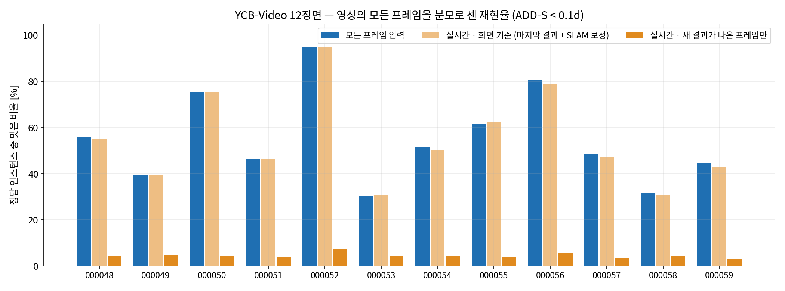
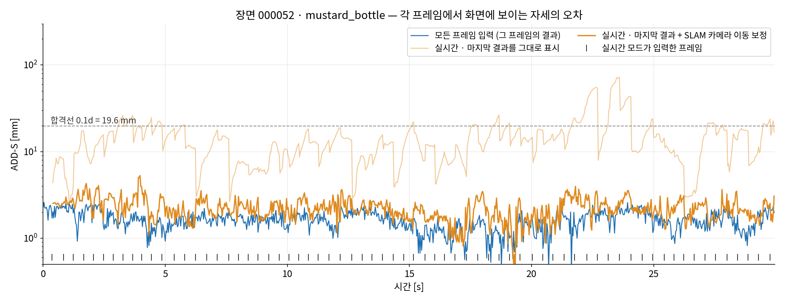
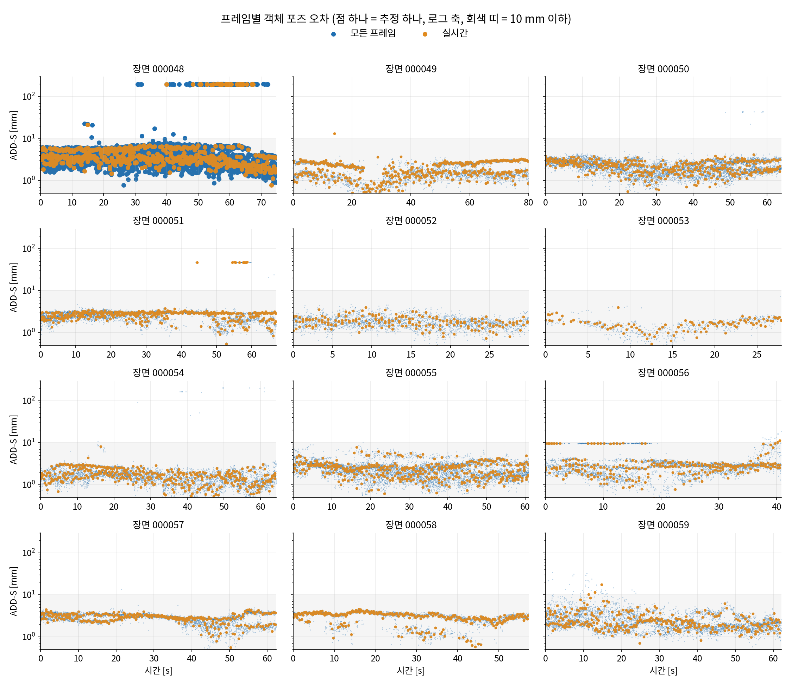
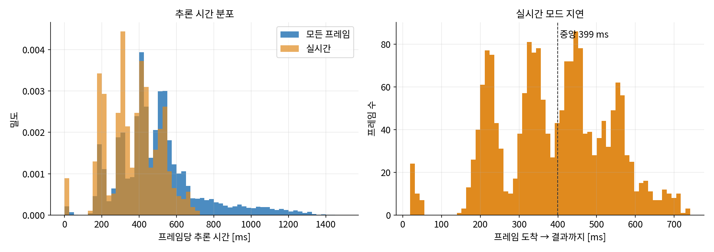

# YCB-Video — 개선된 SAM-6D: 모든 프레임 입력 vs 실시간 입력 (2026-09-22)

같은 YCB-V 테스트 12장면(20,738프레임)을 **같은 SAM-6D 설정**으로 두 번 돌렸다. 두 실행의 차이는
**프레임을 넣는 방식 하나뿐**이다.

| 모드 | 입력 방식 | 처리한 프레임 |
|---|---|---|
| **모든 프레임** | 1번부터 끝까지 한 장씩 차례로 넣는다. 버리는 프레임 없음 (오프라인 상한) | 20,738 (100%) |
| **실시간** | 영상이 30 fps 로 벽시계에 맞춰 들어온다고 보고, 추론이 끝난 순간 **이미 도착한 가장 최신 프레임 하나**를 넣는다. 그 사이 프레임은 버린다. 다음 프레임이 아직 안 왔으면 올 때까지 기다린다 | 1,846 (8.9%) |

## 구성

* SAM-6D 설정은 `ycbv_bop_lane_260919.md` 의 개선판과 같다:
  * `run_split_example.yaml` 의 verify 스택
  * `configs/yolo_ism_ycbv.yaml` (HSV 게이트 off, per-box owner election off)
  * 속도 프리셋 `fast` (fine_npoint 1024, 마스크 캐시)
  * 장면별 대상 객체 목록 (BOP `scene_gt.json`)
* 실행기: `tools/ycbv_sam6d/run_ycbv_sam6d.py --mode all|realtime`
  * `Sam6DCore` 를 프로세스 안에서 직접 부른다. hub·SLAM 스트림·객체 메모리는 거치지 않는다.
  * 모델을 올린 뒤 첫 실제 프레임은 CUDA 준비로 약 3 s 가 걸린다. 그래서 시계를 켜기 전에 두 번 예열하고 마스크 캐시를 비운다.
* 채점·그림: `tools/ycbv_sam6d/compare_modes.py`
* 산출물:
  * `output/ycbv_sam6d_all_260921/`, `output/ycbv_sam6d_realtime_260921/` (장면별 `sam6d_frames.jsonl` · `sam6d_estimates.jsonl` · `run.json`, 전원 기록 `power.log`)
  * 그림 `docs/figs_ycbv_sam6d/`
* 실행 환경: 이 PC(RTX 5090 Laptop) 한 대, **AC 전원**.
  * 두 실행 모두 `power.log` 에 방전 기록이 0회다.
  * 실시간 모드는 GPU 를 혼자 썼다.

### 지표

기준은 YCB-Video 관례대로 ADD(-S) < 0.1 × 객체 지름이다. GT 인스턴스는 visib_fract ≥ 0.1 인 것만 센다. 합계 98,547개.

| 지표 | 뜻 |
|---|---|
| ADD / ADD-S | **추정이 나온 경우만** 센 조건부 정확도 |
| 처리 프레임 재현율 | 처리한 프레임에 보이는 GT 인스턴스 중 ADD-S 를 통과한 비율 |
| 영상 전체 재현율 | 영상 **모든** 프레임의 GT 인스턴스 중 **그 프레임의 결과**가 통과한 비율. 실시간 모드는 결과가 없는 프레임을 놓친 것으로 센다 |
| **화면 기준 재현율** | 실시간 모드에서, 프레임 k 의 시각(k/30 s)에 **이미 나와 있는** 가장 최근 결과를 프레임 k 의 답으로 본다. 사용자가 실제로 보는 것이다. 두 가지로 잰다: **hold** = 마지막 결과를 카메라 좌표 그대로 표시 / **SLAM 보정** = `ycbv_slam_vs_gt_260921.md` 의 ORB-SLAM3 궤적으로 결과 프레임 → 현재 프레임 카메라 이동을 곱해 줌 |

## 결과 — 전체

| | 모든 프레임 | 실시간 |
|---|---|---|
| 처리한 프레임 | 20,738 (100%) | **1,846 (8.9%)** |
| 추정 수 | 52,979 | 4,135 |
| ADD < 0.1d (추정이 있을 때) | 90.2% | 90.3% |
| ADD-S < 0.1d (추정이 있을 때) | **99.3%** | **99.2%** |
| 처리 프레임 재현율 | 53.4% | 48.5% |
| 영상 전체 재현율 (그 프레임의 결과만) | **53.4%** | 4.2% |
| 화면 기준 재현율 · hold | — | 47.2% |
| 화면 기준 재현율 · **SLAM 보정** | — | **52.8%** |
| 프레임당 추론 시간 (중앙) | 464 ms* | **377 ms** |
| 프레임 도착 → 결과 (중앙) | — | **0.40 s** |

\* 모든 프레임 모드는 처음 약 50분 동안 두 프로세스가 GPU 를 나눠 썼다. 그래서 추론 시간 분포에 800–1400 ms 꼬리가 있다.
정확도에는 영향이 없다. 속도 기준값은 실시간 모드의 377 ms 로 본다.

### 읽는 법

1. **자세 정확도는 두 모드가 같다.** ADD-S 99.3% 대 99.2%, ADD 90.2% 대 90.3%.
   프레임을 버려도 **처리한 프레임의 결과 품질은 그대로**다.
2. **프레임 단위로 세면 실시간 모드는 11분의 1이다.** 영상 전체 재현율이 53.4% 대 4.2%다.
   추론 한 번(약 0.4 s)마다 약 11프레임이 지나가므로 당연한 결과다.
3. **그러나 화면에 보이는 것으로 세면 거의 따라잡는다.** 마지막 결과를 SLAM 카메라 이동으로 보정해 들고 있으면
   52.8% 로, 모든 프레임 입력(53.4%)과 **0.6%p 차이**다. 보정 없이 들고만 있으면 47.2% 로 6.2%p 떨어진다.
   카메라가 0.4 s 동안 움직인 만큼 화면의 자세가 어긋나기 때문이다.
   - 이 차이는 카메라가 빨리 도는 장면에서 크다. 000052 는 hold 65.7% → SLAM 보정 95.0% 이고, 모든 프레임 입력은 94.9% 다.
   - SLAM 보정에 쓴 궤적은 GT 가 아니라 **ORB-SLAM3 추정값**이다(ATE RMSE 16.8 mm).
4. **실패 양상도 두 모드가 같다.** 못 잡는 것은 검출이다. 한 번 잡힌 객체의 자세는 99% 맞는다.
   모든 프레임을 넣어도 gelatin_box · pudding_box 는 0건이고, potted_meat_can 2건 · large_clamp 1건 · foam_brick 9건 · bowl 22건이다.

## 결과 — 장면별

| 장면 | 프레임 | 처리(실시간) | ADD-S<0.1d 모든 | ADD-S<0.1d 실시간 | 영상 전체 재현율 모든 | 영상 전체 재현율 실시간 | 화면 기준 hold | 화면 기준 SLAM 보정 | 지연 중앙 [s] |
|---|---|---|---|---|---|---|---|---|---|
| 000048 | 2243 | 172 (7.7%) | 96.1% | 95.0% | 56.0% | 4.2% | 44.0% | 54.9% | 0.45 |
| 000049 | 2401 | 324 (13.5%) | 100.0% | 99.8% | 39.5% | 4.8% | 38.0% | 39.4% | 0.31 |
| 000050 | 1916 | 111 (5.8%) | 99.9% | 100.0% | 75.4% | 4.4% | 73.7% | 75.6% | 0.61 |
| 000051 | 2008 | 178 (8.9%) | 98.0% | 97.8% | 46.2% | 3.9% | 46.6% | 46.6% | 0.37 |
| 000052 | 899 | 70 (7.8%) | 100.0% | 100.0% | 94.9% | 7.5% | 65.7% | 95.0% | 0.45 |
| 000053 | 836 | 113 (13.5%) | 100.0% | 100.0% | 30.1% | 4.1% | 25.2% | 30.7% | 0.25 |
| 000054 | 1928 | 168 (8.7%) | 99.7% | 100.0% | 51.6% | 4.3% | 48.9% | 50.5% | 0.42 |
| 000055 | 1829 | 115 (6.3%) | 100.0% | 100.0% | 61.5% | 3.9% | 52.9% | 62.6% | 0.55 |
| 000056 | 1225 | 85 (6.9%) | 100.0% | 100.0% | 80.7% | 5.5% | 76.8% | 78.9% | 0.47 |
| 000057 | 1871 | 132 (7.1%) | 100.0% | 100.0% | 48.4% | 3.3% | 41.1% | 47.1% | 0.51 |
| 000058 | 1719 | 249 (14.5%) | 100.0% | 100.0% | 31.5% | 4.4% | 30.8% | 30.9% | 0.23 |
| 000059 | 1863 | 129 (6.9%) | 99.9% | 100.0% | 44.7% | 3.0% | 31.5% | 42.9% | 0.51 |
| **전체** | **20738** | **1846 (8.9%)** | **99.3%** | **99.2%** | **53.4%** | **4.2%** | **47.2%** | **52.8%** | **0.40** |

실시간 모드의 처리 비율은 장면마다 다르다(5.8–14.5%). 대상 객체가 많을수록 PEM 이 오래 걸리기 때문이다.
객체 5–6개인 000050·000055 가 가장 낮고, 적은 000049·000053·000058 이 가장 높다.

## 결과 — 객체별 (12장면 합)

| 객체 | GT 인스턴스 | 추정 수 모든 | 추정 수 실시간 | ADD-S<0.1d 모든 | ADD-S<0.1d 실시간 | 재현율 모든 | 재현율 실시간 |
|---|---|---|---|---|---|---|---|
| mug | 4072 | 4040 | 285 | 100.0% | 100.0% | 99.2% | 7.0% |
| pitcher_base | 3843 | 3665 | 391 | 100.0% | 100.0% | 95.4% | 10.2% |
| mustard_bottle | 2815 | 2578 | 165 | 100.0% | 100.0% | 91.6% | 5.9% |
| tuna_fish_can | 7406 | 6588 | 579 | 100.0% | 99.8% | 89.0% | 7.8% |
| banana | 3141 | 2506 | 165 | 100.0% | 100.0% | 79.8% | 5.3% |
| bleach_cleanser | 7636 | 5943 | 469 | 100.0% | 100.0% | 77.8% | 6.1% |
| master_chef_can | 7305 | 5736 | 437 | 98.3% | 97.9% | 77.2% | 5.9% |
| tomato_soup_can | 10303 | 7413 | 539 | 100.0% | 100.0% | 71.9% | 5.2% |
| sugar_box | 9885 | 5479 | 514 | 99.9% | 100.0% | 55.4% | 5.2% |
| cracker_box | 5707 | 2899 | 176 | 99.7% | 100.0% | 50.7% | 3.1% |
| power_drill | 6932 | 3315 | 215 | 99.4% | 100.0% | 47.5% | 3.1% |
| scissors | 2008 | 711 | 55 | 99.7% | 100.0% | 35.3% | 2.7% |
| extra_large_clamp | 4114 | 1615 | 111 | 84.2% | 77.5% | 33.1% | 2.1% |
| large_marker | 3734 | 332 | 21 | 100.0% | 100.0% | 8.9% | 0.6% |
| wood_block | 1829 | 125 | 7 | 100.0% | 100.0% | 6.8% | 0.4% |
| bowl | 3237 | 22 | 6 | 100.0% | 100.0% | 0.7% | 0.2% |
| foam_brick | 1871 | 9 | 0 | 100.0% | — | 0.5% | 0.0% |
| large_clamp | 4171 | 1 | 0 | 100.0% | — | 0.0% | 0.0% |
| potted_meat_can | 5100 | 2 | 0 | 100.0% | — | 0.0% | 0.0% |
| gelatin_box | 1719 | 0 | 0 | — | — | 0.0% | 0.0% |
| pudding_box | 1719 | 0 | 0 | — | — | 0.0% | 0.0% |

(재현율 = 영상 전체 재현율, 그 프레임의 결과만)

ADD-S 가 100% 에서 벗어나는 것은 extra_large_clamp(84%) 뿐이다. 000048 의 ADD-S 약 200 mm 점들이 이것이다.
쌍둥이인 large_clamp 자리에 붙은 추정으로 보인다.

## 그림

**장면별 재현율 — 영상의 모든 프레임을 분모로** (파랑 = 모든 프레임, 연주황 = 실시간 화면 기준 + SLAM 보정, 주황 = 실시간 새 결과만)



**화면에 보이는 자세의 오차 — 시간축** (000052 · mustard_bottle)

모든 프레임 입력(파랑)은 프레임마다 1–3 mm 다. 실시간 모드에서 마지막 결과를 그대로 들고 있으면(연주황) 다음 결과가 나올 때까지
오차가 톱니처럼 커지고, 70 mm 까지 벌어진다. SLAM 카메라 이동으로 보정하면(주황) 톱니가 사라지고 파랑과 거의 겹친다.
아래 눈금은 실시간 모드가 실제로 입력한 프레임이다.



**프레임별 객체 포즈 오차 — 12장면** (점 하나 = 추정 하나, 로그 축)



**추론 시간과 실시간 지연**



## 9/19 배치 수치와의 관계 — 인스턴스 재현율의 분모

`bop_results_260919.md` 의 YCB-V **인스턴스 재현율 63.0%(4088/6494)** 는 이 문서의 "처리 프레임 재현율"과 정의가 같아야 한다.
그런데 `eval_bop_run.py` 의 전체 합계는 **추정이 한 건이라도 있는 객체만** 분모에 더한다.
한 번도 검출되지 않은 객체 5종의 GT 인스턴스 1,836개가 빠진 것이다. 이를 넣으면 9/19 배치도
**4088 / 8330 = 49.1%** 로, 이번 실시간 모드의 처리 프레임 재현율 48.5% 와 맞는다.
이 문서의 재현율은 전부 **모든 GT 를 분모로** 셌다. 논문 표에 63.0% 를 쓸 경우 이 차이를 고쳐야 한다.

## 실행 기록 — 무효 처리한 두 번의 실행

| 폴더 | 무효 사유 |
|---|---|
| `output/ycbv_sam6d_realtime_260921_INVALID_battery_throttle/` | 충전기가 제대로 꽂혀 있지 않아 배터리로 돌았다. GPU 전력 한도가 33–55 W 로 묶였고, 000050 부터 프레임당 1–3.4 s 로 느려졌다. 중간에 멈췄다 |
| `output/ycbv_sam6d_realtime_260921_INVALID_early_frame_bug/` | 추론이 33 ms 보다 빨리 끝나면(검출 없음) **아직 도착하지 않은 다음 프레임**을 가져가는 버그가 있었다. 약 60프레임이 음수 지연이었다. 도착까지 기다리도록 고친 뒤 다시 돌린 것이 본 결과다 |

`output/ycbv_sam6d_all_260921/000050_partial_killed/` 는 두 프로세스 동시 실행이 한 프로세스보다 느려서 중간에 멈춘 조각이다.
000050 은 이후 처음부터 다시 돌렸다.

## 다시 돌리기

```bash
PY=/home/jucpark/anaconda3/envs/sam6d/bin/python
$PY objpose/tools/ycbv_sam6d/run_ycbv_sam6d.py --mode realtime --out objpose/output/ycbv_sam6d_realtime_<날짜>   # 약 15분, GPU 단독
$PY objpose/tools/ycbv_sam6d/run_ycbv_sam6d.py --mode all      --out objpose/output/ycbv_sam6d_all_<날짜>        # 약 2.5시간
python3 objpose/tools/ycbv_sam6d/compare_modes.py --all <all> --rt <realtime> \
    --slam objpose/output/ycbv_slam_orb_260921 --figs objpose/docs/figs_ycbv_sam6d
```

실시간 모드는 전원 상태에 결과가 직접 좌우된다. **AC 전원**과 `nvidia-smi` 전력 한도(95 W)를 확인한 뒤 돌린다.
각 모드를 한 번씩만 돌렸으므로 실행마다 달라지는 편차는 재지 않았다.
