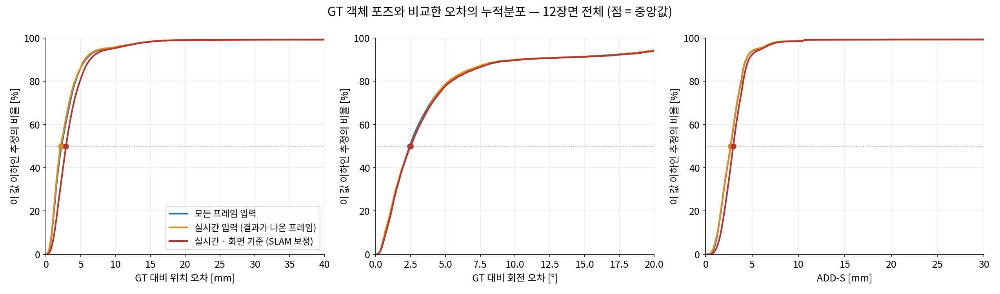
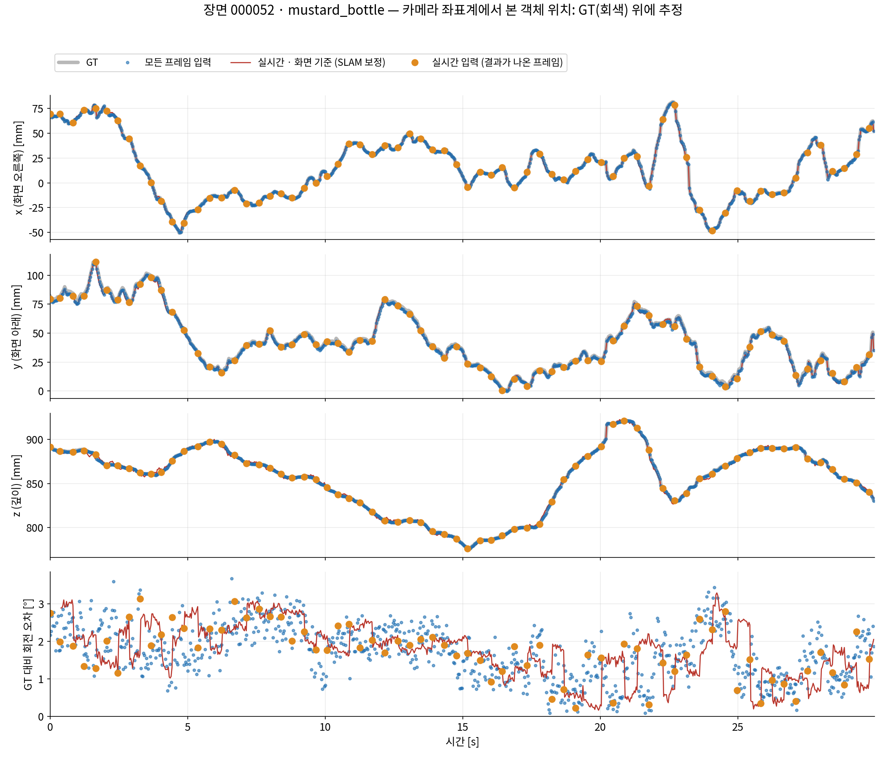
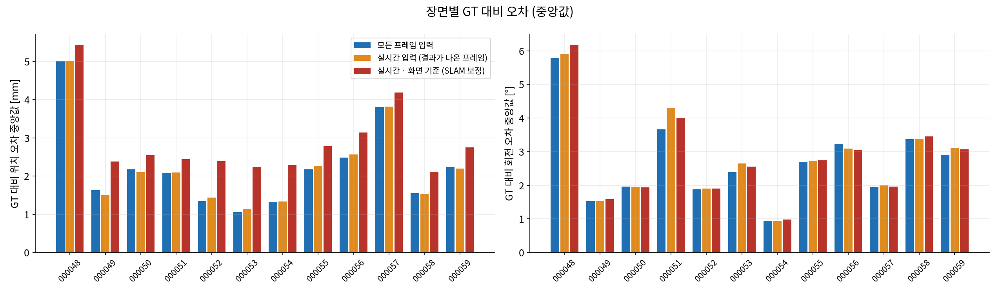
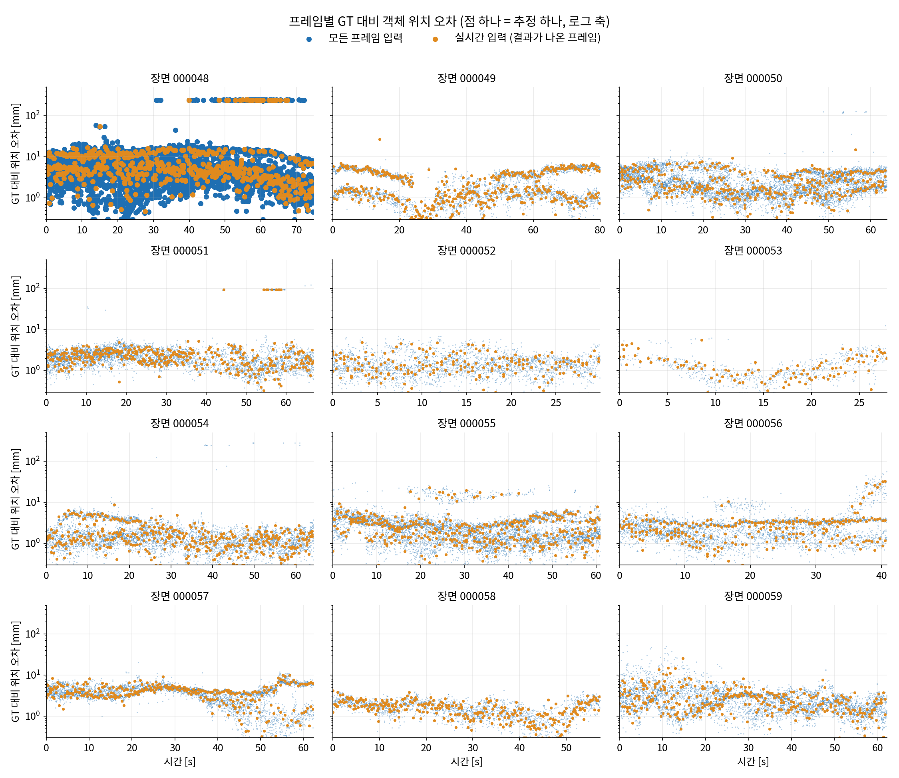
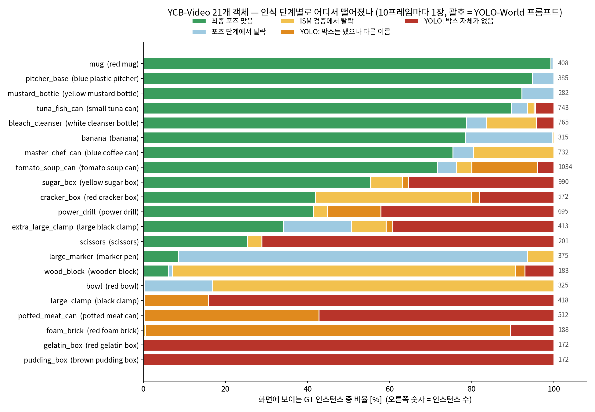
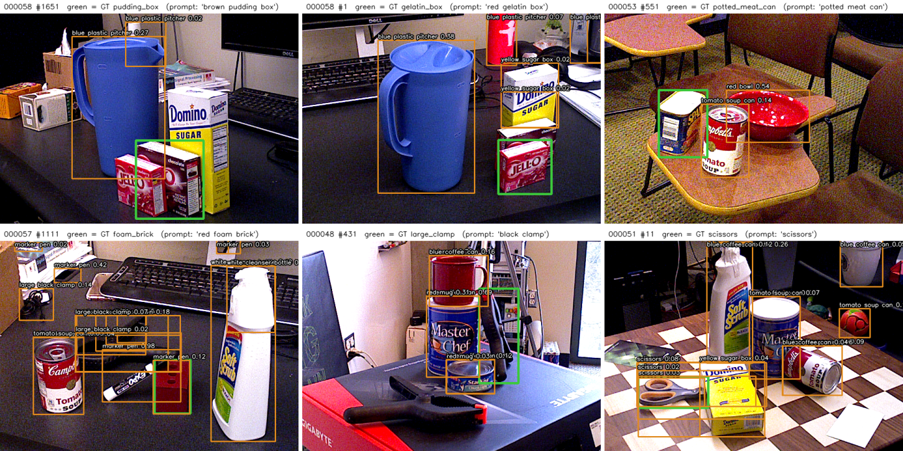

# YCB-Video — SAM-6D 객체 포즈를 GT 객체 포즈와 비교 (2026-09-22)

`ycbv_sam6d_all_vs_realtime_260922.md` 의 두 실행을 이번에는 **서로 견주지 않고, 각각을 GT 객체 포즈와 직접 비교**한다.
이어서 영상 위에 겹쳐 그린 결과와, YOLO-World 단계에서 인식되지 않는 객체를 정리한다.

## 무엇을 GT 와 비교했나

| 비교 대상 | 추정 | GT |
|---|---|---|
| **모든 프레임 입력** | 각 프레임의 SAM-6D 추정 | 그 프레임의 GT 객체 포즈 |
| **실시간 입력 (결과가 나온 프레임)** | 실시간으로 처리된 1,846프레임의 추정 | 그 프레임의 GT |
| **실시간 · 화면 기준 (SLAM 보정)** | 프레임 k 시각에 이미 나와 있던 가장 최근 결과를 ORB-SLAM3 카메라 이동으로 프레임 k 에 옮긴 것 | 프레임 k 의 GT |

같은 프레임·같은 객체의 추정과 GT 를 짝지어 카메라 좌표계에서 잰다.

| 오차 | 정의 |
|---|---|
| 위치 오차 | 객체 모델 원점의 3D 거리 \|t_est − t_gt\| [mm]. 깊이(z)와 화면 방향(xy)으로도 나눴다 |
| 회전 오차 | R_est 와 R_gt 사이의 각도 [°] |
| ADD-S | 아래 설명 [mm] |

대칭 물체(캔·그릇·클램프 등)는 BOP `models_info.json` 에 적힌 대칭 변환 가운데 추정에 가장 가까운 것을 GT 로 쓴다.
BOP 채점 방식과 같다.

### ADD-S 와 ADD-S < 0.1d

* **ADD**: 물체 3D 모델 표면의 점들을 추정 포즈와 GT 포즈로 각각 옮기고, **같은 점끼리**의 거리를 평균한 값 [mm].
  위치와 회전 오차가 한 숫자에 함께 담긴다.
* **ADD-S**: 대칭 물체는 축을 돌려도 모양이 같아 "어느 각도가 정답"인지가 없다. 그래서 추정 쪽 각 점에서
  **GT 표면의 가장 가까운 점**까지의 거리를 평균한다. 표면이 겹치면 작다.
* **ADD-S < 0.1d**: d = 물체 지름. ADD-S 가 지름의 10% 보다 작으면 "맞은 포즈"로 친다(YCB-Video/PoseCNN 관례).
  예: mustard_bottle(지름 196 mm)은 19.6 mm 이내, tuna_fish_can(지름 90 mm)은 9.0 mm 이내.

## 결과 — GT 대비 오차 (12장면, 화면에 보이는 GT 인스턴스 98,547개)

| GT 와 비교한 값 | 모든 프레임 입력 | 실시간 입력 (결과가 나온 프레임) | 실시간 · 화면 기준 (SLAM 보정) |
|---|---|---|---|
| 비교된 추정 수 | 52,979 | 4,135 | 52,500 |
| 추정을 받은 GT 인스턴스 | 52,979 (53.8%) | 4,135 (4.2%) | 52,500 (53.3%) |
| **위치 오차 중앙값 [mm]** | **2.2** | **2.1** | **2.9** |
| 위치 오차 평균 [mm] | 4.4 | 4.6 | 5.1 |
| 위치 오차 90% 지점 [mm] | 5.7 | 5.6 | 6.3 |
|   └ 깊이(z) 오차 중앙값 [mm] | 0.9 | 0.8 | 1.3 |
|   └ 화면 방향(xy) 오차 중앙값 [mm] | 1.7 | 1.7 | 2.1 |
| **회전 오차 중앙값 [°]** | **2.4** | **2.5** | **2.5** |
| 회전 오차 평균 [°] | 8.0 | 7.3 | 8.0 |
| 회전 오차 90% 지점 [°] | 10.3 | 10.1 | 10.5 |
| ADD-S 중앙값 [mm] | 2.7 | 2.7 | 3.0 |
| ADD-S < 0.1d 통과 (비교된 추정 중) | 99.3% | 99.2% | 99.2% |
| GT 인스턴스 중 통과 | 53.4% | 4.2% | 52.9% |

* 세 경우 모두 **GT 에서 위치 약 2–3 mm, 회전 약 2.5° 떨어져 있다.**
  실시간 입력은 프레임을 버려도, 처리한 프레임의 정확도가 모든 프레임 입력과 같다(2.1 mm 대 2.2 mm).
* 화면 기준(SLAM 보정)은 위치가 0.7 mm 더 나쁘다(2.9 mm). 0.4 s 전 결과를 ORB-SLAM3 카메라 이동으로
  옮겨 오면서 SLAM 오차가 더해지기 때문이다. 깊이보다 화면 방향 오차가 조금 더 커진다.
* 회전 오차는 평균(7–8°)이 중앙값(2.5°)보다 훨씬 크다. master_chef_can 의 중앙값이 9.6–16.2° 인 탓이다.
  이 캔은 BOP 가 180° 대칭만 적어 두었는데, 실제로는 원통이라 축 둘레 회전을 판별할 수 없다.
  ADD-S 로는 맞고 회전 각도로만 틀리게 보인다.
* 정답을 못 받은 GT 인스턴스(모든 프레임 입력 기준 46%)는 **포즈가 틀려서가 아니라 추정이 아예 없어서**다.
  원인은 아래 "YOLO-World 단계" 절에서 다룬다.

### 장면별 (중앙값)

| 장면 | 위치 [mm] 모든 | 위치 실시간 | 위치 화면(SLAM) | 회전 [°] 모든 | 회전 실시간 | 회전 화면(SLAM) | GT 중 통과 모든 | 실시간 | 화면(SLAM) |
|---|---|---|---|---|---|---|---|---|---|
| 000048 | 5.0 | 5.0 | 5.4 | 5.78 | 5.91 | 6.19 | 56.0% | 4.2% | 55.0% |
| 000049 | 1.6 | 1.5 | 2.4 | 1.53 | 1.53 | 1.59 | 39.5% | 4.8% | 39.4% |
| 000050 | 2.2 | 2.1 | 2.6 | 1.96 | 1.95 | 1.93 | 75.4% | 4.4% | 75.6% |
| 000051 | 2.1 | 2.1 | 2.4 | 3.67 | 4.30 | 4.00 | 46.2% | 3.9% | 46.6% |
| 000052 | 1.3 | 1.4 | 2.4 | 1.88 | 1.90 | 1.90 | 94.9% | 7.5% | 95.0% |
| 000053 | 1.1 | 1.1 | 2.2 | 2.39 | 2.65 | 2.55 | 30.1% | 4.1% | 30.7% |
| 000054 | 1.3 | 1.3 | 2.3 | 0.95 | 0.94 | 0.98 | 51.6% | 4.3% | 50.5% |
| 000055 | 2.2 | 2.3 | 2.8 | 2.70 | 2.73 | 2.75 | 61.5% | 3.9% | 62.6% |
| 000056 | 2.5 | 2.6 | 3.1 | 3.24 | 3.09 | 3.05 | 80.7% | 5.5% | 78.9% |
| 000057 | 3.8 | 3.8 | 4.2 | 1.94 | 2.00 | 1.96 | 48.4% | 3.3% | 47.1% |
| 000058 | 1.6 | 1.5 | 2.1 | 3.37 | 3.39 | 3.45 | 31.5% | 4.4% | 30.9% |
| 000059 | 2.2 | 2.2 | 2.8 | 2.91 | 3.12 | 3.07 | 44.7% | 3.0% | 42.9% |

객체별 표(위치·회전 중앙값)는 `figs_ycbv_sam6d_gt/tables_vs_gt.md`, 추정 하나하나의 오차는 `figs_ycbv_sam6d_gt/errors_vs_gt.csv` 에 있다.

### 그림

**GT 대비 오차의 누적분포** — 세 곡선이 거의 겹친다. 화면 기준(빨강)만 위치에서 약간 오른쪽이다.

**GT 궤적 위에 추정 — 000052 · mustard_bottle, 카메라 좌표계의 x·y·z 와 회전 오차.**
회색 굵은 선이 GT 다. 파란 점(모든 프레임)과 주황 점(실시간 결과), 빨간 선(화면 기준)이 모두 그 위에 올라탄다.

**장면별 GT 대비 오차 (중앙값)**

**12장면 — 프레임별 GT 대비 위치 오차** (로그 축)

## 영상 위에서 본 결과

초록 = GT 포즈, 파랑 = 모든 프레임 입력, 주황 = 실시간 입력(화면에 떠 있는 결과, SLAM 보정)으로, 객체의 3D 박스를 영상에 투영했다.
각 장면의 가운데쯤에서 실시간 결과가 새로 나오지 않은 프레임을 골랐다. 즉 주황 박스는 **0.3–0.8 s 전 결과를 옮겨 온 것**이다.

* 색 박스가 초록 박스와 거의 겹치면 포즈가 맞은 것이다. **초록 박스만 있고 색 박스가 없는 물체가 인식에 실패한 물체**다.
  예: 000058 의 JELL-O 상자 두 개(gelatin_box, pudding_box), 000059 의 SPAM 캔(potted_meat_can), 000057 의 빨간 스펀지 큐브(foam_brick), 000053 의 빨간 그릇(bowl).
* 동영상(좌: 모든 프레임 입력, 우: 실시간 화면): `output/ycbv_sam6d_overlay_260922/overlay_000052.mp4` (30 s), `overlay_000048.mp4` (75 s).
  git 저장소를 키우지 않으려고 docs 가 아니라 output 에 두었다.

## YOLO-World 단계에서 인식되지 않는 객체

`tools/ycbv_sam6d/diag_ycbv_stages.py` 로 12장면을 10프레임마다 한 장씩(2,074장), 화면에 보이는 GT 인스턴스 9,880개에 대해 단계별로 셌다.
인식기 설정은 위 실행과 같다.

| 단계 | 판정 |
|---|---|
| ① | YOLO-World 가 GT 박스와 IoU ≥ 0.5 인 박스를 냈는가 (라벨 무관) |
| ② | 그 박스가 **그 객체 자신의 프롬프트** 라벨인가 |
| ③ | ISM(DINOv2) 검증을 통과했는가 |
| ④ | 최종 포즈가 ADD-S < 0.1d 로 맞았는가 |

| 객체 | YOLO 프롬프트 | GT 인스턴스 | ① 박스 (라벨 무관) | ② 박스 (자기 프롬프트) | ③ ISM 통과 | ④ 최종 맞음 | ①은 되고 ②가 안 될 때 붙은 이름 |
|---|---|---|---|---|---|---|---|
| **pudding_box** | brown pudding box | 172 | **0.0%** | **0.0%** | 0.0% | 0.0% | |
| **gelatin_box** | red gelatin box | 172 | **0.0%** | **0.0%** | 0.0% | 0.0% | |
| **potted_meat_can** | potted meat can | 512 | 42.8% | **0.2%** | 0.2% | 0.2% | yellow sugar box, tomato soup can |
| **large_clamp** | black clamp | 418 | 15.8% | **0.2%** | 0.2% | 0.2% | power drill, large black clamp |
| **foam_brick** | red foam brick | 188 | 89.4% | **0.5%** | 0.0% | 0.0% | marker pen (167회) |
| scissors | scissors | 201 | 28.9% | 28.9% | 25.4% | 33.3% | |
| power_drill | power drill | 695 | 57.8% | 44.7% | 41.4% | 46.6% | red cracker box, marker pen |
| extra_large_clamp | large black clamp | 413 | 60.8% | 59.1% | 50.6% | 34.1% | |
| sugar_box | yellow sugar box | 990 | 64.5% | 63.1% | 55.4% | 55.3% | |
| cracker_box | red cracker box | 572 | 81.8% | 79.9% | 42.0% | 48.8% | |
| tomato_soup_can | tomato soup can | 1034 | 96.0% | 80.0% | 76.2% | 71.7% | white cleanser bottle (163회) |
| wood_block | wooden block | 183 | 92.9% | 90.7% | **7.1%** | 6.0% | |
| tuna_fish_can | small tuna can | 743 | 95.4% | 95.2% | 93.5% | 89.6% | |
| bleach_cleanser | white cleanser bottle | 765 | 95.7% | 95.7% | 83.7% | 78.7% | |
| master_chef_can | blue coffee can | 732 | 100% | 100% | 80.3% | 75.4% | |
| mug | red mug | 408 | 100% | 100% | 99.8% | 99.3% | |
| bowl | red bowl | 325 | 100% | 100% | **16.9%** | 0.3% | |
| mustard_bottle | yellow mustard bottle | 282 | 100% | 100% | 100% | 92.2% | |
| banana | banana | 315 | 100% | 100% | 99.7% | 78.4% | |
| pitcher_base | blue plastic pitcher | 385 | 100% | 100% | 100% | 94.8% | |
| large_marker | marker pen | 375 | 100% | 100% | 93.6% | **8.5%** | |
| **전체** | | **9,880** | **77.9%** | **70.4%** | **59.3%** | **53.1%** | |

(④가 ③보다 큰 경우가 있는 것은 진단기와 실제 실행의 마스크 캐시 등 세부 경로 차이 때문이다. 수 % 이내다.)

### 답: YOLO-World 에서 막히는 객체

**YOLO-World 단계에서 사실상 전혀 인식되지 않는 객체는 21종 중 5종이다.** 자기 프롬프트로 박스가 나오는 비율이 1% 미만이다.

| 객체 | 증상 |
|---|---|
| **pudding_box**, **gelatin_box** | 박스 자체가 한 번도 안 나온다(0%). 실물은 빨간 JELL-O 상자인데 프롬프트는 "brown pudding box"·"red gelatin box" 다 |
| **potted_meat_can** | 43% 는 박스가 나오지만 "yellow sugar box"·"tomato soup can" 이름이 붙는다. 실물은 SPAM 캔이다 |
| **foam_brick** | 89% 에서 박스가 나오지만 거의 전부 **"marker pen"** 으로 붙는다. 빨간 작은 큐브다 |
| **large_clamp** | 박스가 16% 만 나오고, 나와도 "power drill"·"large black clamp"(쌍둥이 extra_large_clamp 의 프롬프트)로 붙는다 |

**절반 이하로만 잡히는 객체가 4종 더 있다**(자기 프롬프트 박스 29–63%): scissors 29%, power_drill 45%, extra_large_clamp 59%, sugar_box 63%.

아래는 각 객체가 가장 잘 보이는 프레임에서 YOLO-World 를 돌린 결과다. 초록 = GT, 주황 = YOLO-World 박스(프롬프트 이름·신뢰도).

### YOLO-World 는 통과하지만 뒤 단계에서 막히는 객체

YOLO-World 는 잡는데 뒤 단계에서 막히는 것도 3종이 있다. 원인이 YOLO 가 아니므로 따로 적는다.

| 객체 | 막히는 단계 | 원인 |
|---|---|---|
| **bowl** | ISM | YOLO 박스는 100% 나오지만 ISM 이 83% 를 **semantic 점수 미달(below-sim)** 로 버린다 |
| **wood_block** | ISM | 91% → 7%. 역시 below-sim |
| **large_marker** | 포즈 단계 | ISM 까지 94% 통과하지만 최종 포즈가 8.5% 만 맞는다. 가늘고 긴 펜이라 깊이 점이 적어 PEM 이 흔들리는 것으로 보인다(확인 필요) |

### 개선 방향 (아직 해 보지 않음)

1. **프롬프트를 실물 모양대로**: "jello box", "red jello pudding box", "spam can", "small red cube"처럼 바꿔 본다.
   다만 `ycbv_bop_lane_260919.md` 에서 검출률만 최대화하는 프롬프트는 장면에 없는 물체까지 잡는 오검출을 만들었다.
   그래서 **ISM 검증 통과 수**로 판정해야 한다.
2. bowl·wood_block 은 YOLO 가 아니라 ISM 문제다. 템플릿 렌더(색·재질)와 실제 영상의 차이를 먼저 확인한다.

## 산출물

| | 경로 |
|---|---|
| GT 대비 채점 | `tools/ycbv_sam6d/eval_vs_gt.py` → `docs/figs_ycbv_sam6d_gt/` (표 `tables_vs_gt.md`, 추정별 오차 `errors_vs_gt.csv`, 그림) |
| 영상 겹쳐 그리기 | `tools/ycbv_sam6d/render_overlay.py` → `overlay_grid.png`, `output/ycbv_sam6d_overlay_260922/*.mp4` |
| 단계별 진단 | `tools/ycbv_sam6d/diag_ycbv_stages.py` → `stages.md`, `stages.json` · `plot_stages.py` → `stages_by_object.png` |
| YOLO 실패 예시 | `tools/ycbv_sam6d/yolo_examples.py` → `yolo_failures.png` |
