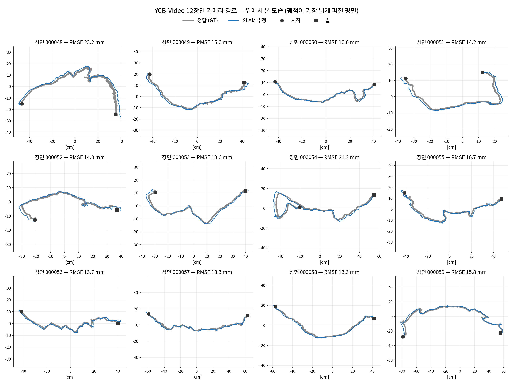
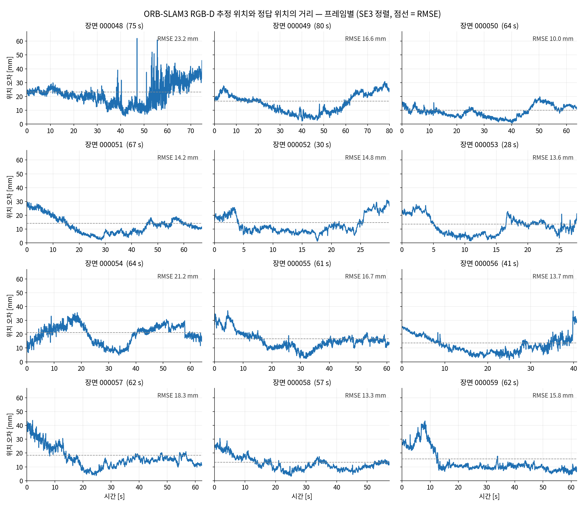
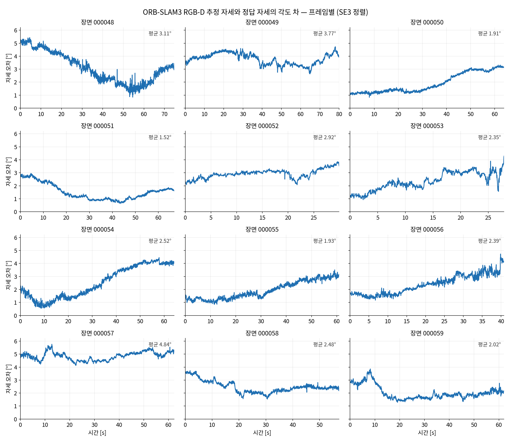
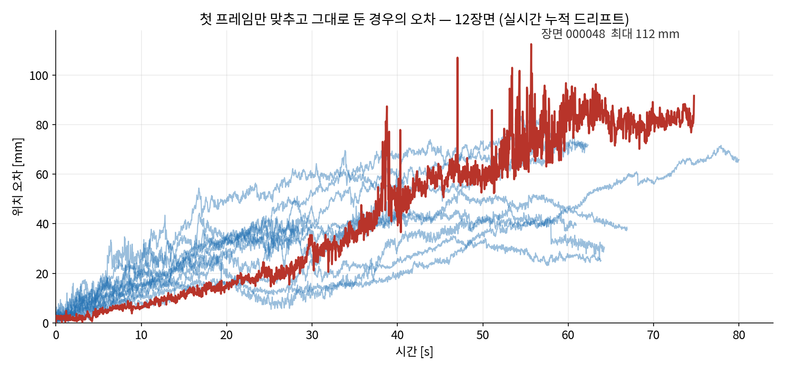
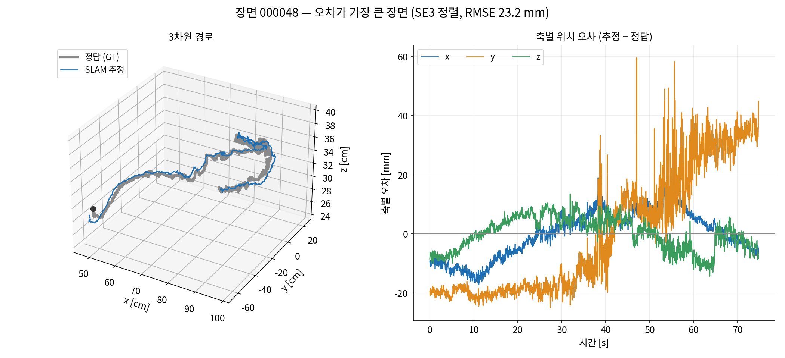

# YCB-Video — SLAM 추정 카메라 위치 vs 정답(GT) 위치 (2026-09-21)

`ycbv_bop_lane_260919.md` 의 YCB-V 레인은 SLAM 자리에 **GT 카메라 포즈**를 넣어 객체 포즈만
평가했다. 이 문서는 그 빈칸, 즉 **SLAM 자체가 YCB-V 에서 카메라 위치를 얼마나 맞히는가**를 잰다.

## 구성

* SLAM: ORB-SLAM3 **RGB-D** (이 PC 에 빌드된 `CLI_environment/orbslam_ws/src/ORB_SLAM3/lib/libORB_SLAM3.so`)
* 실행기: `tools/ycbv_slam/ycbv_rgbd.cc` — BOP 폴더(`rgb/`, `depth/`)를 30 fps 시계로 한 장씩 넣는다.
  `TrackRGBD` 가 돌려준 **그 순간의 포즈**를 프레임마다 기록(`*_frames.txt`, "현재 위치")하고,
  종료 후 BA 가 반영된 궤적(`*_final.txt`)도 따로 저장한다.
* 설정: `tools/ycbv_slam/ycbv_uw.yaml` — `scene_camera.json` 의 K 그대로, 왜곡 0,
  `DepthMapFactor 10000`(YCB-V depth 단위 0.1 mm), ORB 1500점. 12장면 모두 같은 카메라.
* 채점: `tools/ycbv_slam/eval_ycbv_slam.py` (정렬·RMSE 는 `slam_comparison_report/loc_eval/metrics.py` 재사용)
* 산출물: `output/ycbv_slam_orb_260921/` (궤적 · 타이밍 · 로그 · `eval_slam.json`), 그림 `docs/figs_ycbv_slam/`

SLAM 월드는 첫 카메라 좌표계라 GT 월드와 강체 변환만큼 어긋나 있다. 두 가지로 맞춰 쟀다.

| 정렬 | 방법 | 보는 것 |
|---|---|---|
| **SE3 정렬 (ATE)** | 전체 궤적에 Umeyama, 스케일 없음 (RGB-D 라 스케일이 정해져 있음) | TUM 표준 절대 궤적 오차 |
| **첫 프레임 고정** | 첫 프레임에서만 맞추고 이후는 그대로 | 실시간으로 쓸 때 쌓이는 드리프트 |

## 결과 — 12개 테스트 장면, 20,738 프레임

| 장면 | 프레임 | 길이 [s] | GT 이동거리 [m] | 추적 성공 | **ATE RMSE [mm]** | ATE 평균 | ATE 최대 | 자세 오차 평균 [°] | RPE 1 s [mm] | RPE 1 s [°] | 첫 프레임 고정 · 끝 오차 [mm] | BA 후 ATE [mm] |
|---|---|---|---|---|---|---|---|---|---|---|---|---|
| 000048 | 2243 | 74.8 | 8.85* | 100% | **23.2** | 21.8 | 62.0* | 3.11 | 8.7* | 0.58 | 91.6 | 23.5 |
| 000049 | 2401 | 80.0 | 2.66 | 100% | **16.6** | 15.1 | 30.8 | 3.77 | 3.9 | 0.32 | 65.8 | 16.6 |
| 000050 | 1916 | 63.9 | 2.00 | 100% | **10.0** | 9.1 | 19.8 | 1.91 | 2.7 | 0.19 | 25.2 | 10.7 |
| 000051 | 2008 | 66.9 | 2.03 | 100% | **14.2** | 12.7 | 29.6 | 1.52 | 2.8 | 0.21 | 37.8 | 14.5 |
| 000052 | 899 | 30.0 | 1.87 | 100% | **14.8** | 13.3 | 30.9 | 2.92 | 6.2 | 0.44 | 38.4 | 14.6 |
| 000053 | 836 | 27.9 | 1.99 | 100% | **13.6** | 12.0 | 27.8 | 2.35 | 7.1 | 0.57 | 39.8 | 13.7 |
| 000054 | 1928 | 64.3 | 3.09 | 100% | **21.2** | 20.0 | 35.6 | 2.52 | 5.4 | 0.32 | 30.5 | 17.4 |
| 000055 | 1829 | 61.0 | 2.93 | 100% | **16.7** | 15.5 | 37.0 | 1.93 | 4.6 | 0.28 | 39.5 | 14.8 |
| 000056 | 1225 | 40.8 | 1.43 | 100% | **13.7** | 12.2 | 36.7 | 2.39 | 4.9 | 0.41 | 57.2 | 13.9 |
| 000057 | 1871 | 62.4 | 2.71 | 100% | **18.3** | 16.7 | 43.7 | 4.84 | 5.2 | 0.32 | 71.8 | 18.6 |
| 000058 | 1719 | 57.3 | 1.86 | 100% | **13.3** | 12.4 | 30.6 | 2.48 | 4.1 | 0.27 | 65.1 | 13.8 |
| 000059 | 1863 | 62.1 | 3.13 | 100% | **15.8** | 13.5 | 43.2 | 2.02 | 4.9 | 0.34 | 71.0 | 15.7 |
| **전체** | **20,738** | **691** | **34.6** | **100%** | **16.8** (전 프레임) | 14.9 (중앙 13.4) | 62.0 | 2.69 | | | 25–92 | |

\* 000048 은 **GT 자체가 튄다** — 아래 참고.

* **추적 실패 0, 맵 재생성 0** — 12장면 모두 첫 프레임부터 끝까지 한 맵으로 추적.
* 장면별 ATE RMSE **10.0 – 23.2 mm**, 전체 프레임을 모은 RMSE **16.8 mm**. 자세 오차 평균 **2.7°**.
* 첫 프레임만 맞추고 그대로 두면 끝에서 **25 – 92 mm** (1 분 안팎 · 경로 2–3 m 기준 약 1–3 %).
* 종료 후 BA 반영본(오른쪽 끝 열)도 거의 같다 — 장면마다 한 번 지나가는 궤적이라 루프가
  닫히지 않아 사후 최적화가 고칠 것이 없다. 000054 만 21.2 → 17.4 mm.
* 추적 시간 프레임당 중앙 **29.9 ms** (4장면 동시 실행 중) — 30 fps 실시간 수준.

### 000048 은 GT 가 튄다

000048 의 오차 곡선에 있는 40 – 60 mm 바늘은 SLAM 이 아니라 GT 에서 온다. 같은 프레임에서 GT 카메라는
한 프레임(33 ms) 사이에 **46 – 50 mm** 를 뛰고 SLAM 은 0.6 – 1.7 mm 움직인다. 프레임 간 이동이 20 mm 를
넘는 경우가 GT 에 44번 있고 SLAM 에는 한 번도 없다(SLAM 최대 5.4 mm). 나머지 11장면의 GT 에는
이런 튐이 없다(프레임 간 이동 p99 2.7 – 7.2 mm). YCB-Video 의 GT 카메라 포즈는 사람이 직접 잰 값이 아니라
재구성에서 구한 값이므로, 000048 의 ATE 최대값·RPE·GT 이동거리는 GT 잡음이 부풀린 값이다.

## 그림

**추적 경로 — 12장면, 위에서 본 모습** (회색 굵은 선 = GT, 파란 선 = SLAM, SE3 정렬)



**프레임별 위치 오차 — 시간축** (점선 = 그 장면의 RMSE)



**프레임별 자세 오차 — 시간축**



**첫 프레임만 맞춘 경우 — 실시간 누적 드리프트** (빨강 = 최대 장면 000048)



**오차가 가장 큰 장면 000048 — 3차원 경로와 축별 오차**



## 다시 돌리기

```bash
# 빌드 (sam6d conda 의 OpenCV/Pangolin, 기존 libORB_SLAM3.so 에 링크)
O=/home/jucpark/DeepLearning/CLI_environment/orbslam_ws/src/ORB_SLAM3; E=/home/jucpark/anaconda3/envs/sam6d
g++ -O2 -std=c++14 -DHAVE_GLEW -DHAVE_EIGEN objpose/tools/ycbv_slam/ycbv_rgbd.cc -o ycbv_rgbd \
  -I$O -I$O/include -I$O/include/CameraModels -I$O/Thirdparty/Sophus -I$E/include/eigen3 -I$E/include/opencv4 -I$E/include \
  -L$O/lib -L$O/Thirdparty/DBoW2/lib -L$O/Thirdparty/g2o/lib -L$E/lib -lORB_SLAM3 -lDBoW2 -lg2o \
  -lopencv_core -lopencv_imgcodecs -lopencv_imgproc -lpango_display -lpango_opengl -lpango_core \
  -lpango_windowing -lpango_vars -lpango_image -lGLEW -lGL -Wl,--allow-shlib-undefined \
  -Wl,-rpath,$O/lib:$O/Thirdparty/DBoW2/lib:$O/Thirdparty/g2o/lib:$E/lib

# 한 장면
./ycbv_rgbd $O/Vocabulary/ORBvoc.txt objpose/tools/ycbv_slam/ycbv_uw.yaml <YCB_Video>/test/000048 2243 out/000048

# 채점 + 그림
python3 objpose/tools/ycbv_slam/eval_ycbv_slam.py --run objpose/output/ycbv_slam_orb_260921 \
  --data /home/jucpark/DeepLearning/Datasets/paper_benchmarks/YCB_Video/test --figs objpose/docs/figs_ycbv_slam
```

이번 실행은 이 PC 에서 이미지 폴더를 오프라인으로 넣은 것이다(노트북 · LAN 을 거치지 않음). 한 번씩만
돌렸으므로 ORB-SLAM3 의 실행마다 달라지는 편차는 재지 않았다.
