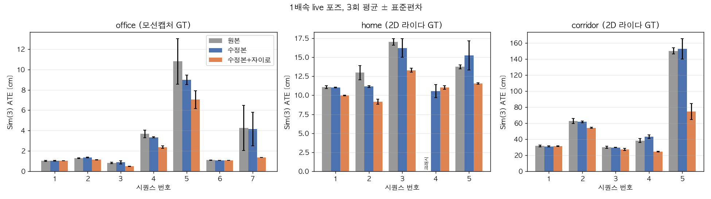
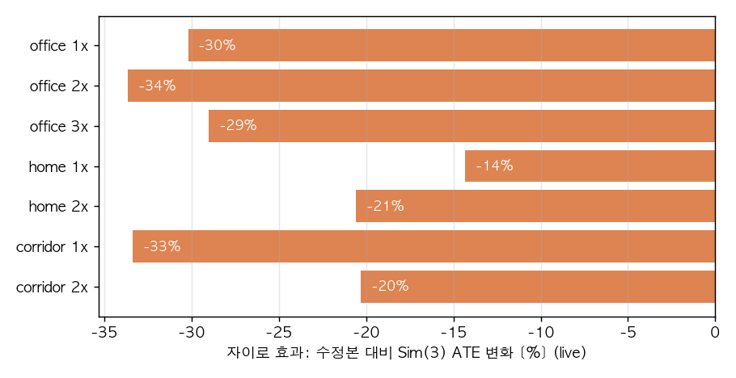

# OpenLORIS-Scene 실험 보고서: 원본 ORB-SLAM3 vs 수정본 vs 수정본+자이로

작성일: 2026-10-18. 실험 기간: 2026-10-17 ~ 18. 장비: Mac M4 Pro.
관련 커밋(mac-live-slam-viewer): `c185c84b` (실행기·office), `8b16355d` (home·corridor, 구간 평가, 크래시 수정 2건).

## 요약

- **자이로 보조가 세 장면 모두에서 위치 오차를 줄였다.** 수정본(자이로 없음) 대비 Sim(3) ATE가 office에서 −30%,
  home에서 −14~21%, corridor에서 −19~33% 줄었다. 1배속 live 기준으로 17개 시퀀스 중 14개에서 나았고,
  나머지 3개는 같은 수준이었다.
- **효과는 오차가 큰 시퀀스에서 크다.** office1-7은 −67%, corridor1-5는 −51%, corridor1-4는 −43%다.
  이미 1 cm 수준인 시퀀스는 변화가 없다.
- **수정본의 속도 개선(추적 시간 약 −40%)은 정확도를 떨어뜨리지 않았다.** 원본과 수정본(자이로 없음)의 차이는 반복 편차 안이다.
- **안정성:** 원본은 실행 중이나 종료 때 11회 죽었다(Sim3Solver NaN 8회, 종료 시 mutex 3회). 수정본은 0회다. 실험 중 원본에서 물려받은 버그 1건을 새로 찾아 고쳤다.
- **자이로는 추적 상실 자체를 막지는 못한다.** 추적 정상 비율과 맵 끊김 횟수는 세 버전이 같다.





## 1. 목적

이 저장소의 ORB-SLAM3 수정본이 원본보다 나은지, GT가 있는 공개 데이터셋에서 검증한다.
대상은 세 가지 수정이다. 특히 자이로 보조를 본다.
이전에 우리 데이터(260901)로 했던 비교는 KISS-ICP를 기준으로 삼았다. 기준 자체의 오차가 커서 자이로 효과가 거의 보이지 않았다.

| 수정 | 내용 |
|---|---|
| 자이로 보조 | 프레임 사이 회전을 자이로 적분으로 예측한다(모션 모델). PoseOptimization에 회전 사전 엣지, LocalBA에 상대 회전 엣지를 더한다. 루프 후보를 회전으로 거부하고, 정지 구간에서 바이어스를 갱신한다. 회전만 다루는 tightly-coupled 방식이다 |
| 실시간 설정 C | `Optimizer.PoseIterations [10,5,5,5]`, `PoseEarlyExit 1`: 포즈 최적화 반복 수를 줄이고 수렴하면 조기 종료 |
| 버그 수정 | isBad 교착, DetectNBestCandidates 무한 루프, Sim3Solver NaN, Shutdown 대기 등. 이번 실험에서 2건 추가(6절) |
| 루프 임계값 완화 | BoW 0.8→0.5, 연속 일치 3→1, 매칭 수 축소. 저장소 초기 커밋부터 들어 있다 |

## 2. 실험 구성

### 데이터: OpenLORIS-Scene

지상 로봇에 RealSense D435i를 단 데이터셋이다(컬러 + 정렬 depth 848×480, 자이로 400 Hz, 하드웨어 동기).
우리 장비 구성과 거의 같다. 받은 곳은 Hugging Face 미러 `shixuesong/openloris-scene`이다.

| 장면 | 시퀀스 | GT | 길이 / 이동 거리 | 특징 |
|---|---|---|---|---|
| office | 7 | OptiTrack 모션캡처 (mm 급, 6자유도) | 짧음, 최대 0.4 m/s | 질감이 많다. 세 버전 모두 추적을 한 번도 잃지 않는다 |
| home | 5 | 2D 라이다 Hector SLAM (cm 급, 평면 3자유도) | 26–152 s / 6–40 m | 가구 사이를 회전이 많은 경로로 다닌다. 맵이 1–7개로 끊긴다 |
| corridor | 5 | 2D 라이다 Hector SLAM (cm 급, 평면 3자유도) | 63–272 s / 70–230 m | 긴 복도, 질감이 적다. 맵이 자주 끊기고 드리프트가 크다 |

### 비교 대상

| 이름 | 소스 | 설정 |
|---|---|---|
| 원본 (`upstream`) | UZ-SLAMLab ORB-SLAM3 `v1.0-release` + macOS 이식 수정 | `openloris_d400.yaml` |
| 수정본 (`ours`) | `orbslam_ws/src/ORB_SLAM3` | 같은 yaml + 실시간 설정 C |
| 수정본+자이로 (`ours_gyro`) | 같은 빌드 | 수정본 + D435i 자이로 (`--gyro`) |

세 버전 모두 같은 실행기(`openloris_rgbd.cc`), 같은 컴파일 옵션과 의존성, 특징점 1000개로 돌렸다.

### 실행 조건

- **실시간 재생:** 30 Hz 벽시계로 프레임을 내보낸다. 추적이 늦으면 최신 5장만 남기고 오래된 프레임을 버린다.
- **빠른 움직임 모사:** 2배·3배속은 k장마다 1장을 30 Hz로 재생한다. 프레임 사이 움직임이 k배가 된다.
  office는 1·2·3배, home·corridor는 1·2배를 돌렸다.
- **반복:** 3회. 기계 부하 변화가 한 버전에만 걸리지 않도록 세 버전을 번갈아 실행했다.
- **실행 수:** office 189회, home 90회, corridor 90회(재실행 제외).

### 평가 지표

| 지표 | 설명 |
|---|---|
| Sim(3) ATE | 공식 평가 도구(`openloris-scene-tools/benchmark/evaluate.py`)에 스케일 정렬을 켜고 계산한 위치 오차 RMSE. **주 지표** |
| SE(3) ATE | 공식 기본값. 스케일을 맞추지 않는다 |
| CR | 공식 correct rate. 올바른 포즈가 있는 시간 비율 |
| live / final | live = 프레임마다 그 순간 내놓은 포즈(실시간 성능) / final = 종료 후 전역 최적화한 궤적 |

**Sim(3)을 주 지표로 쓰는 이유:**
office에서는 모든 버전의 궤적이 GT보다 일정하게 약 5% 작았다(구간 이동 거리 비 1.045–1.052).
D435i depth나 모션캡처 쪽 스케일 문제로 보이며, 세 버전에 똑같이 작용한다.
이 편향이 SE(3) ATE(약 8 cm)를 지배해서, 자이로 효과가 −6%로만 보인다. 스케일을 맞추면 −30%다.

**맵 구간별 평가 (home·corridor):**
- RGB-D ORB-SLAM3는 추적을 완전히 잃으면 원점이 다른 새 맵을 만든다. 수정본은 끊긴 맵을 옛 맵에 병합하기도 하는데,
  그 순간 live 포즈가 옛 맵 좌표계로 점프한다.
- 그래서 공식 평가처럼 전체를 한 번에 정렬하면 ATE가 수 m, 방향 오차가 약 180°로 나와 의미가 없다.
- 이 경우 `eval_openloris.py`가 다음과 같이 계산한다(`seg_*` 열).
  1. 새 맵이 시작될 때와 포즈가 0.25 m 넘게 점프할 때 궤적을 나눈다.
  2. 5초 이상인 조각을 각각 공식 평가로 정렬한다.
  3. 모든 포즈에 대한 RMSE로 합친다.
- 맵이 하나인 office에서는 이 값이 공식 값과 정확히 같다.

## 3. 결과: 시퀀스별 (1배속, live, Sim(3) ATE [cm], 3회 평균 ± 표준편차)

### office

| 시퀀스 | 원본 | 수정본 | 수정본+자이로 | 자이로 효과 |
|---|---|---|---|---|
| office1-1 | 1.04 ± 0.06 | 1.05 ± 0.05 | 1.05 ± 0.01 | 0% |
| office1-2 | 1.30 ± 0.05 | 1.36 ± 0.03 | **1.14** ± 0.03 | −16% |
| office1-3 | 0.82 ± 0.07 | 0.89 ± 0.16 | **0.50** ± 0.02 | −44% |
| office1-4 | 3.68 ± 0.38 | 3.34 ± 0.05 | **2.39** ± 0.13 | −28% |
| office1-5 | 10.80 ± 2.23 | 8.98 ± 0.47 | **7.05** ± 0.88 | −21% |
| office1-6 | 1.11 ± 0.03 | 1.07 ± 0.01 | 1.07 ± 0.00 | 0% |
| office1-7 | 4.28 ± 2.21 | 4.16 ± 1.66 | **1.36** ± 0.01 | −67% |
| **평균** | 3.29 | 2.98 | **2.08** | **−30%** |

### home

| 시퀀스 | 길이 | 원본 | 수정본 | 수정본+자이로 | 자이로 효과 |
|---|---|---|---|---|---|
| home1-1 | 152 s, 40 m | 11.1 ± 0.2 | 11.0 ± 0.0 | **10.0** ± 0.0 | −9% |
| home1-2 | 100 s, 31 m | 13.0 ± 0.9 | 11.2 ± 0.1 | **9.1** ± 0.3 | −19% |
| home1-3 | 88 s, 24 m | 17.0 ± 0.4 | 16.2 ± 1.2 | **13.3** ± 0.3 | −18% |
| home1-4 | 71 s, 20 m | 크래시 3/3 | 10.6 ± 0.9 | 11.0 ± 0.2 | +4% (편차 안) |
| home1-5 | 26 s, 6 m | 13.7 ± 0.3 | 15.2 ± 1.9 | **11.5** ± 0.1 | −24% |
| **평균** | | 13.70 (4개) | 12.84 | **11.00** | **−14%** |

### corridor

| 시퀀스 | 길이 | 원본 | 수정본 | 수정본+자이로 | 자이로 효과 |
|---|---|---|---|---|---|
| corridor1-1 | 272 s, 230 m | 31.8 ± 1.2 | 31.2 ± 0.8 | 31.4 ± 0.6 | 0% |
| corridor1-2 | 116 s, 143 m | 62.8 ± 3.2 | 61.8 ± 1.0 | **54.4** ± 0.8 | −12% |
| corridor1-3 | 70 s, 75 m | 30.2 ± 1.2 | 29.9 ± 0.4 | **27.4** ± 1.4 | −8% |
| corridor1-4 | 63 s, 70 m | 38.5 ± 2.4 | 43.4 ± 2.2 | **24.6** ± 0.5 | −43% |
| corridor1-5 | 146 s, 126 m | 150.3 ± 3.8 | 152.8 ± 12.8 | **74.7** ± 10.2 | −51% |
| **평균** | | 62.7 | 63.8 | **42.5** | **−33%** |

## 4. 결과: 조건별 요약 (Sim(3) ATE [cm], 시퀀스 평균)

| 장면 | 조건 | 포즈 | 원본 | 수정본 | 수정본+자이로 | 자이로 효과 | 자이로가 나은 시퀀스 |
|---|---|---|---|---|---|---|---|
| office | 1배 | live | 3.29 ± 0.70 | 2.98 ± 0.37 | **2.08** ± 0.16 | −30% | 6/7 |
| office | 1배 | final | 2.90 ± 0.78 | 2.55 ± 0.46 | **1.84** ± 0.19 | −28% | 5/7 |
| office | 2배 | live | 3.12 ± 0.51 | 3.06 ± 0.40 | **2.03** ± 0.07 | −34% | 6/7 |
| office | 2배 | final | 2.67 ± 0.57 | 2.53 ± 0.22 | **1.74** ± 0.07 | −31% | 5/7 |
| office | 3배 | live | 2.30 ± 0.79 | 2.55 ± 0.11 | **1.81** ± 0.07 | −29% | 5/7 |
| office | 3배 | final | 2.00 ± 0.77 | 2.30 ± 0.15 | **1.55** ± 0.09 | −33% | 5/7 |
| home | 1배 | live | 13.70\* | 12.84 | **11.00** | −14% | 4/5 |
| home | 1배 | final | 13.86\* | 13.01 | **11.27** | −13% | 4/5 |
| home | 2배 | live | 13.66 | 13.31 | **10.57** | −21% | 5/5 |
| home | 2배 | final | 13.70 | 13.54 | **10.90** | −20% | 5/5 |
| corridor | 1배 | live | 62.7 | 63.8 | **42.5** | −33% | 4/5 |
| corridor | 1배 | final | 61.4 | 51.4 | **41.5** | −19% | 4/5 |
| corridor | 2배 | live | 55.4 | 52.7 | **42.0** | −20% | 4/5 |
| corridor | 2배 | final | 51.1 | 49.7 | **40.5** | −19% | 4/5 |

office의 ±는 반복 3회 사이 시퀀스 평균값의 표준편차다.
\* home1-4에서 원본이 3회 모두 크래시해서, 원본 1배 값은 시퀀스 4개 평균이다.

office 1배 live의 기타 지표 (원본 / 수정본 / 수정본+자이로):

| 지표 | 원본 | 수정본 | 수정본+자이로 |
|---|---|---|---|
| 공식 SE(3) ATE | 7.87 cm | 7.70 cm | 7.26 cm |
| 최대 오차 | 16.0 cm | 15.3 cm | 12.5 cm |
| 방향 오차 (AOE) | 2.18° | 2.08° | 1.84° |
| CR (0.1 m, 5° 이내) | 0.77 | 0.79 | 0.81 |

## 5. 속도와 추적 유지

| 항목 | 원본 | 수정본 | 수정본+자이로 |
|---|---|---|---|
| 추적 시간 평균: office | 7.9 ms | 4.6 ms | 4.6 ms |
| 추적 시간 평균: home | 7.9 ms | 4.8 ms | 4.8 ms |
| 추적 시간 평균: corridor | 8.0 ms | 5.1 ms | 5.1 ms |
| 추적 시간 P99: home / corridor | 10.6 / 15.4 ms | 7.7 / 18.2 ms | 7.8 / 17.2 ms |
| 추적 정상 프레임 비율: home / corridor | 0.90 / 0.91 | 0.90 / 0.91 | 0.90 / 0.92 |
| 점수를 매긴 맵 조각 수: home / corridor | 3.0 / 3.3 | 3.2 / 3.3 | 3.1 / 3.3 |

- 30 Hz 실시간 재생에서 버린 프레임은 거의 없다. 예외는 수정본 corridor1-1 재실행 1회(298장)뿐이다.
- corridor에서는 맵 조각이 시퀀스당 20–30개 생긴다. 대부분 5초 미만이라 평가에서 빠진다.
  평가된 조각(약 3.3개)이 전체 시간의 약 90%를 덮는다.

## 6. 안정성 (크래시)

| 원인 | 원본 | 수정본 | 수정본+자이로 | 조치 |
|---|---|---|---|---|
| `Sim3Solver` 0/0 → NaN (`SO3::exp failed`) | 5 (office 1, home 4) + corridor 3 | 0 | 0 | 수정본에서 이미 고친 버그. 실패한 실행은 평균에서 제외 |
| 종료 시 `mutex lock failed` (Shutdown이 스레드 종료를 기다리지 않음) | 3 (office) | 0 | 0 | 수정본에서 이미 고친 버그 |
| `LocalMapping::Release()`가 이미 맵에 있는 키프레임을 delete → 다음 맵 리셋에서 해제된 mutex 접근 | – | 1 (corridor) | 0 | **이번에 수정**(`LocalMapping.cc`). 원본에도 같은 코드가 있다 |
| `MapPoint::ComputeDistinctiveDescriptors`의 N×N 스택 배열. macOS 보조 스레드 스택(512 KB) 초과 | 37회 (corridor, 세 버전 공통) | | | **이번에 수정**(`MapPoint.cc`). 원본에도 이식 패치로 적용 후 재실행 |

마지막 줄은 macOS에서만 나는 문제다. Linux는 스레드 스택이 8 MB라 N이 훨씬 커야 난다.
원본·수정본 비교에서는 공통 이식 수정으로 취급했다.

## 7. 해석

1. **자이로 효과는 조건이 바뀌어도 같은 방향이다.**
   - GT 방식(모션캡처, 라이다), 장면, 속도(1·2·3배), 포즈 종류(live, final)가 달라도 모두 오차가 줄었다.
   - 같은 시퀀스를 반복했을 때의 편차(대부분 0.1–1 cm)보다 자이로에 따른 차이가 크다.
2. **효과는 회전이 영상 추정을 흔드는 구간에서 나오는 것으로 보인다.**
   - 오차가 큰 시퀀스(office1-5·1-7, corridor1-4·1-5)에서 개선 폭이 크다.
   - 이미 1 cm 수준인 시퀀스(office1-1·1-6)는 변화가 없다.
3. **자이로가 듣지 않은 시퀀스**
   - corridor1-1은 거의 직선 복도라 회전이 적다. 오차가 주로 이동 방향(스케일·병진) 드리프트일 가능성이 크다(미검증).
   - home1-4의 차이는 반복 편차 안이다.
4. **자이로는 추적 상실을 막지 못한다.** 지금 구현은 회전만 보조한다.
   흰 벽이나 빠른 회전 중 블러처럼 영상 특징이 없는 구간에서는 세 버전 모두 똑같이 추적이 끊긴다.
5. **속도 개선은 정확도를 바꾸지 않는다.**
   - 원본과 수정본(자이로 없음)의 차이는 대부분 반복 편차 안이다.
   - 예외는 corridor 1배 final이다(61.4 → 51.4 cm). 루프 임계값 완화로 끊긴 맵을 더 자주 병합한 효과로 보이지만,
     분리 실험으로 확인되지 않았다.
6. **live와 final의 차이는 작다.** home·office에서 0.2–0.4 cm다.
   전역 최적화 뒤에도 자이로 효과가 거의 그대로 남는다. 즉 실시간 포즈뿐 아니라 지도 품질에도 효과가 있다.

## 8. 한계와 주의점

- **home·corridor의 절대 오차에는 GT 품질이 섞여 있다.**
  - 2D 라이다 GT는 평면 3자유도이고 cm 급이다.
  - 카메라와 시간도 약간 어긋난다. home1-3은 GT 시간을 +0.3 s 옮기면 ATE가 16 → 13 cm로 줄었다.
  - 세 버전에 똑같이 작용하므로 상대 비교는 유효하다. 절대 정확도는 office를 대표값으로 쓴다.
- **맵 구간별 평가는 이 실험에서 정의한 방식이다.** 논문에는 방법을 명시하고, 공식 단일 정렬 수치와 CR도 함께 싣는다(`results/*.csv`에 모두 있다).
- **크래시한 원본 실행은 평균에서 빠졌다.** 원본 수치가 실제보다 유리하게 나왔을 수 있다.
- **SE(3) ATE와 Sim(3) ATE를 함께 보고해야 한다.** office의 약 5% 스케일 편향 때문이다.
- **반복은 3회다.** 같은 시퀀스 안의 편차는 작지만, 장면 단위의 통계 검정을 하려면 시퀀스 수가 적다(장면당 5–7개).

## 9. 재현 방법

```bash
orbslam_ws/openloris/build.sh                                   # 원본·수정본 빌드
D=~/Documents/DefenseMeta/Dataset/openloris
for s in office home corridor; do
  orbslam_ws/openloris/run_openloris.sh $D/$s orbslam_ws/output/openloris/runs/${s}_nf1000 3 1000
  STRIDE=2 RATE=2 orbslam_ws/openloris/run_openloris.sh $D/$s orbslam_ws/output/openloris/runs/${s}_nf1000_x2 3 1000
done
orbslam_ws/output/openloris/venv/bin/python orbslam_ws/openloris/eval_openloris.py orbslam_ws/output/openloris/runs/home_nf1000
```

- 데이터 받기, venv 구성, 평가 도구 설치는 `README.md`에 있다.
- 결과 CSV(`results/`)는 한 줄이 실행 1회다. 주요 열:
  - `ate_rmse`, `ate_rmse_sim3`: 공식 단일 정렬
  - `seg_ate_sim3`, `seg_cr`, `seg_n`: 맵 구간별 평가
  - `track_mean_ms`: 추적 시간
  - `dropped`: 버린 프레임 수
  - `ok_ratio`: 추적 정상 프레임 비율

## 10. 다음 실험 후보

1. **분리 실험:** 루프 임계값 완화와 조기 종료를 각각 원본 값으로 되돌려, 각 수정의 기여를 나눈다.
2. **자이로 무효 시퀀스 분석:** corridor1-1, home1-4의 오차를 회전 성분과 병진 성분으로 분해한다.
3. **GT 시간 오프셋 보정:** home·corridor 시퀀스별로 GT 시간 오프셋을 추정해서 보정한 뒤 다시 평가한다.
4. **다른 장면 재현:** cafe, market.
5. **추적 상실 구간 연결:** 회전만 쓰는 지금 구조를 확장해서, 끊긴 구간을 자이로·휠 오도메트리로 잇는다.
