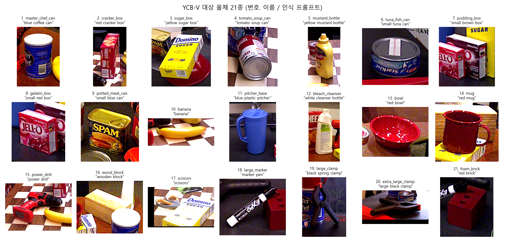
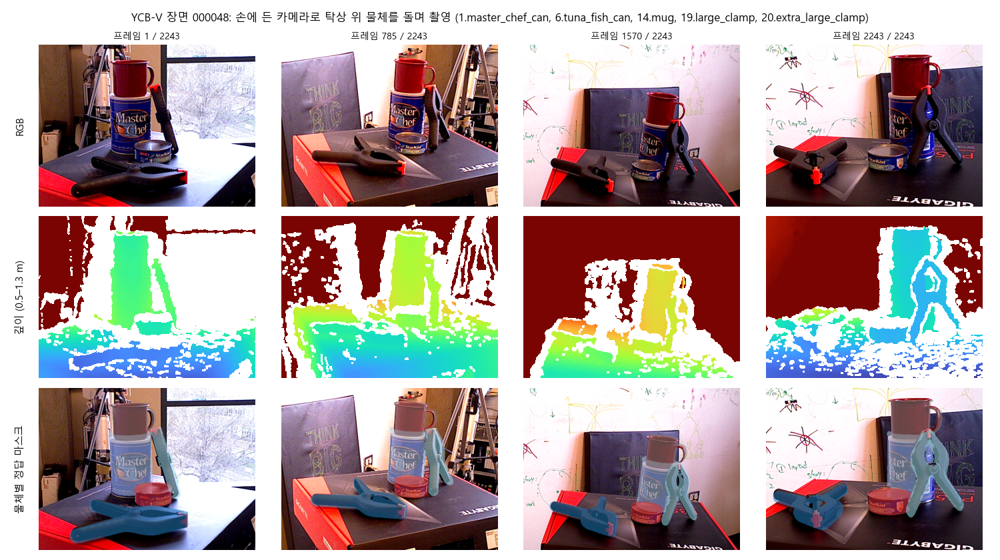
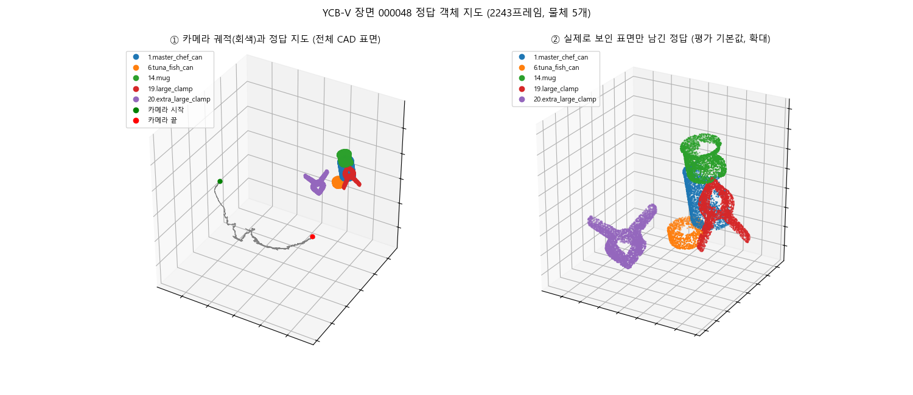
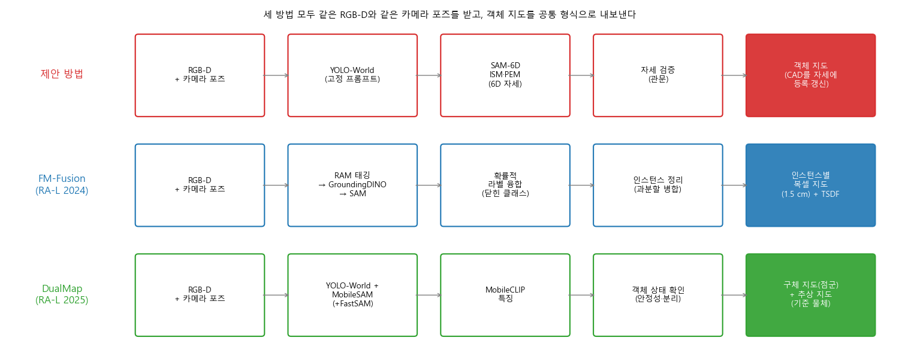

# 객체 지도 비교 실험: 데이터(YCB-V)와 비교 방법(FM-Fusion, DualMap)

YCB-V는 **데이터셋**이고, FM-Fusion과 DualMap은 제안 방법과 비교할 **객체 지도 생성 방법**입니다. 세 방법 모두 같은 YCB-V 영상과 같은 카메라 포즈를 입력으로 받습니다.

그림은 `make_intro_figs.py`로 다시 만들 수 있습니다.

## 1. YCB-Video (YCB-V)

탁자 위에 놓인 YCB 물체 3~6개를 손에 든 RGB-D 카메라(Asus Xtion, 640×480)로 한 바퀴 돌며 찍은 영상 데이터셋입니다(Xiang et al., PoseCNN, RSS 2018). 원본은 영상 92개(학습 80, 시험 12)입니다. 이 PC에는 BOP 형식의 **시험 영상 12개 전체 프레임**(장면 000048~000059, 836~2,401프레임, 합계 약 21,000프레임)이 있고, 실험은 이것으로 합니다.

| 제공 데이터 | 형식 | 실험에서의 쓰임 |
|---|---|---|
| RGB 영상 | `rgb/*.png` | 세 방법의 입력 |
| 깊이 영상 | `depth/*.png` (0.1mm 단위) | 세 방법의 입력, 보인 표면 판정 |
| 카메라 포즈 | `scene_camera.json` | 정확도가 떨어져 물체 정답으로 다시 맞춤 → `poses_tum.txt` |
| 물체별 6D 정답 자세 | `scene_gt.json` | 정답 지도 생성 |
| 물체별 마스크 | `mask_visib/*.png` | 보인 표면 판정, 프레임 단위 평가 |
| CAD 모델 21종 | `models/obj_0000XX.ply` | 정답 점군, 제안 방법의 등록 모델 |

### 대상 물체 21종

물체 이름 아래 따옴표 안 문구가 인식용 프롬프트입니다(`ycbv/paths.py`). 비교의 공정성을 위해 FM-Fusion과 DualMap에도 같은 문구를 넣습니다.

### 장면 예시: 000048

물체 5개(커피캔, 참치캔, 머그, 집게 두 개)가 놓여 있고, 카메라가 2,243프레임 동안 탁자를 돌며 찍습니다.
- 깊이 영상에서 흰색은 값이 없는 곳입니다. 물체 가장자리와 반사면에서 자주 비어 있습니다.
- 마스크 가장자리의 깊이가 뒤 배경을 찍는 일이 있습니다. 이것이 평가기에 `--clean` 옵션을 둔 이유입니다.

### 이 장면의 정답 객체 지도

- **①**: 카메라 궤적과 CAD 전체 표면을 정답 자세에 놓은 지도입니다.
- **②**: 그중 실제로 한 번이라도 보인 표면만 남긴 정답입니다. 평가의 기본값입니다. 바닥이나 탁자에 닿은 면은 보이지 않아 빠집니다(물체별 42~98% 남음).

## 2. FM-Fusion (비교 방법 1)

| 항목 | 내용 |
|---|---|
| 논문 | C. Liu et al., "FM-Fusion: Instance-aware Semantic Mapping Boosted by Vision-Language Foundation Models", IEEE RA-L 2024 (HKUST) |
| 코드 | github.com/HKUST-Aerial-Robotics/FM-Fusion |
| 입력 | RGB-D 영상 + 카메라 포즈(데이터셋 제공 포즈 사용) |
| 인식 | RAM이 영상의 태그를 만들고 → GroundingDINO가 그 태그로 박스를 찾고 → SAM이 마스크를 만듦 |
| 지도 | 물체마다 1.5cm 복셀 지도를 두고, 전체 장면은 TSDF로 따로 쌓음. 여러 프레임의 라벨을 확률적으로 합쳐 닫힌 클래스 하나를 정함. 과분할된 물체는 합침 |
| 원 논문 평가 | ScanNet 30장면(NYUv2 20클래스, mAP50 40.3), SceneNN 5장면 |
| 속도 | RTX 3090에서 프레임당 약 1초(SAM이 0.46초). 10프레임마다 인식하는 오프라인 처리 |

**YCB-V에 쓰려면 바꿀 것**
- 라벨 집합이 NYUv2 20클래스(의자, 책상 등)로 고정돼 있어 YCB 물체가 없습니다. 클래스 목록을 YCB 21종으로 바꿔야 합니다.
- RAM 태그 대신 고정 프롬프트 21개를 GroundingDINO에 넣어야 합니다.
- 결과 물체별 복셀은 그대로 점군으로 꺼내 공통 형식으로 저장합니다.

## 3. DualMap (비교 방법 2)

| 항목 | 내용 |
|---|---|
| 논문 | J. Jiang et al., "DualMap: Online Open-Vocabulary Semantic Mapping for Natural Language Navigation in Dynamic Changing Scenes", IEEE RA-L 2025 (arXiv 2506.01950) |
| 코드 | github.com/Eku127/DualMap (Ubuntu 22.04, ROS 2 Humble, Python 3.10) |
| 입력 | RGB-D 영상 + 카메라 포즈. 자체 위치 추정은 없고, 실제 로봇에서는 FAST-LIO2 포즈를 씀 |
| 인식 | YOLOv8l-World(클래스 목록) + MobileSAM 마스크. 목록 밖 물체는 FastSAM-s. 특징은 MobileCLIP-S2 |
| 지도 | **구체 지도**: 물체별 (점군, 클래스, 특징, 관측 기록). 새 관측은 특징 유사도와 3D 겹침으로 기존 물체에 붙음 (3D 병합 단계 없음). **추상 지도**: 침대, 책상 같은 기준 물체만 남기고 작은 물체는 그 위에 얹힌 정보로 보관 |
| 변화 처리 | 객체 상태 확인. 관측이 적거나 클래스가 흔들리는 물체는 지우고, 한 물체에 다른 클래스가 섞여 나오면 나눔 |
| 원 논문 평가 | Replica, ScanNet200(mIoU, F-mIoU, mAcc), HM3DSem에 YCB 물체를 놓은 동적 내비게이션 |
| 장비 | RTX 4090. RTX 3080 Laptop에서도 시험함 |

**YCB-V에 쓰려면 바꿀 것**
- 클래스 목록(원래 GPT가 만듦)을 고정 프롬프트 21개로 바꿉니다.
- 구체 지도의 물체 점군을 꺼내 공통 형식으로 저장합니다.
- 변화 처리 기능이 있어 ObChange(방문마다 물체 배치가 바뀜) 실험에서 핵심 비교 대상이 됩니다.

## 4. 세 방법 비교

| | 제안 방법 | FM-Fusion | DualMap |
|---|---|---|---|
| 물체 찾기 | YOLO-World (고정 프롬프트) | RAM → GroundingDINO → SAM | YOLO-World + MobileSAM |
| 물체 판정 | SAM-6D로 6D 자세 추정 후 자세 검증 | 여러 프레임 라벨의 확률 융합 | CLIP 특징 + 상태 확인 |
| 지도에 남는 것 | **CAD 모델 + 6D 자세** | 물체별 복셀 | 물체별 점군 |
| 실시간 | 실시간 | 오프라인 (약 1초/프레임) | 온라인 |

지도에 남는 것이 다르기 때문에 제안 방법은 두 가지로 보고합니다. (a) CAD를 추정 자세에 놓은 점군, (b) 실제 관측 점군입니다. 자세한 평가 규칙은 `../README.md`에 있습니다.
